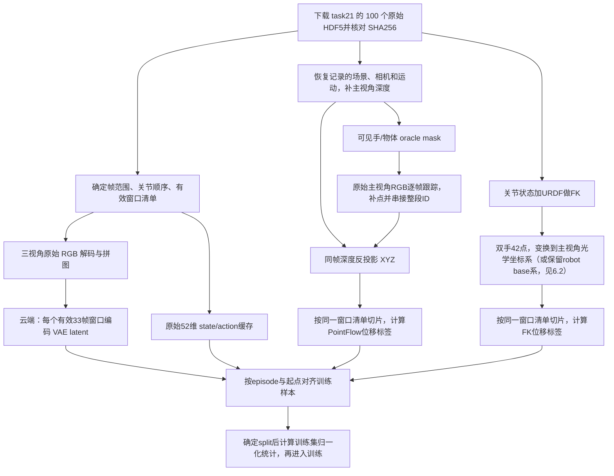

# 仿真数据处理 Pipeline：原始HDF5 → 视频latent / PointFlow / FK → 训练

**云端操作直接看[第8节](#8-云端从上传数据到训练缓存)：** 用task06举例，依次说明输入目录、RGB/VAE生成、两端核对、训练缓存和启动命令；07/21/27只需对照路径表。云端统一使用`datasets/cosmos-cache/`，完整目录与数组规范见[仿真数据目录规范](./sim_pointfk_data_format.md)。

**本地部分保留原有task21说明：** 第1–7节、第10节及本地验收记录中的`outputs/`、`exports/`、本地`tools/`和`utils/`属于本地处理仓库；云端操作使用第8节列出的绝对路径。本次仅整理云端内容。

更新日期：2026-10-07。描述本次 **100 条 replay-generalization 数据**的实际处理方法。依据本地代码、最终产物和云端导出的审计报告整理；不是把早期十条实验的流程当作当前流程。

## 1. 当前结果和整体关系

本地最终版本是 `exports/bench2dex_task21_replay100_pointfk_fullseq_v3`。已核对：100 条完成，60,190 个训练窗口，100 份训练读取检查、100 个完整 episode 可视化 MP4；批处理状态为 `complete`。



RGB latent、PointFlow、FK 是三条并行的数据支路。**VAE latent 只编码视频，不把 action、PointFlow 或 FK 一起编码进去。** PointFlow 必须先对整个 episode 建立连续点身份，再切训练窗口；VAE 则依据云端既有 contract 对每个有效窗口独立编码。

| 内容 | 本次实际来源 | 执行位置 / 确认程度 |
|---|---|---|
| 原始 RGB、关节状态、动作、物体位姿、相机标定 | Bench2Dex 官方录制 HDF5 | 本地与云端源文件 SHA256 已对齐 |
| 三视角 RGB 缓存、state/action | 原始 HDF5 | 本地生成结果与云端历史 RGB 缓存哈希对齐 |
| 主视角深度 | 按原始记录恢复场景后渲染 | 本地完成 |
| PointFlow | RGB 二维跟踪 + 对齐深度，oracle mask 选点 | 本地完成 |
| FK21 × 双手 | 记录的 qpos + URDF FK | 本地完成 |
| VAE latent | 三视角拼图后的有效视频窗口 | 云端已做；本地有审计报告，未重跑全量编码 |
| 当前100条的划分、归一化 | 云端训练装配 | 本地交付保持 `unassigned` 和原始量纲；云端采用94训/6验及训练集统计，见第9节 |

## 2. 第一步：下载什么、如何确定是同一批数据

### 2.1 原始动作与视频数据

- 数据仓库：`Bench2Dex/teleopdata`，Hugging Face dataset。
- 子目录：`dataset/21_condiment_box_loading/replay-generalization/`。
- 文件：`episode_000000.hdf5` 到 `episode_000049.hdf5`，以及对应的 50 个 `_1.hdf5`，共 100 条。
- 本地下载计划锁定 revision：`b195787c65046083e6a43776b67bdf1389dfa3eb`。
- 云端当时请求的是 `main`，没有记录解析后的 commit。因此不能声称云端也使用了上述 commit；我们依据 **100 个文件内容 SHA256 全部相同**确认来源一致。

`xxx` 与 `xxx_1` 是同一组动作/状态轨迹的不同视觉配置，包含背景、材质、光照、相机外参变化。可以复用部分机器人运动学计算，但不能直接共用 RGB 跟踪、可见点和相机坐标结果。seed 相同或文件名相似都不足以证明 RGB 一致。

关键文件：

- [本地下载计划](outputs/sim_pointflow/task21_replay100/plan.json)：每个文件的远端路径、大小、SHA256、保留帧数。
- [源文件身份检查](outputs/sim_pointflow/task21_replay100/source_identity_audit.json)：100/100 SHA256 对齐。
- 原始数据：`outputs/sim_pointflow/task21_replay100/sources/`。
- 云端审计：[README](/home/fangkaipeng/dexmanip_scj/task21_baseline_data_audit_20261005/README.md)、[episodes.csv](/home/fangkaipeng/dexmanip_scj/task21_baseline_data_audit_20261005/episodes.csv)。

已有下载计划时，在仓库根目录执行：

```bash
.venvs/cosmos-local/bin/python tools/fetch_sim_expansion_sources.py \
  --plan outputs/sim_pointflow/task21_replay100/plan.json --workers 3
```

下载器支持断点续传，已有文件先检查大小和 SHA256；不应重复下载通过检查的文件。使用 Python 3.11 环境，脚本使用了 `hashlib.file_digest`。

[生成计划的脚本](tools/plan_task21_replay100.py)依赖云端 `episodes.csv`、本地远端文件列表 `outputs/sim_pointflow/setup/task21_replay_list.json` 及轨迹审计元数据；它并不是不带前置文件即可运行的独立下载入口。

### 2.2 仿真资产与模型权重

补深度和 oracle mask 需要 `Bench2Dex/Assets` 中以下资源，以及它们实际引用的 USD/材质/纹理依赖：

- `Robots_p/ur5+wuji`：机器人 URDF、USD 和视觉几何。
- `Objects/154_wooden_box`、`171_msg`、`172_soy-sauce`、`173_vinegar`。
- 各 HDF5 的 `scene_generalization_sample` 和对象资产路径中记录的场景、杂物、背景、桌面材质等。
- 资产下载脚本使用 revision `bf65215f844d1fca30750e4cc70d7266650abf0a`。

资产目录为仓库旁的 `../dex2bench_dataset`。参考 [fetch_task21_assets.py](tools/fetch_task21_assets.py)；可传 `--episode` 获取记录场景的资源，用 `--reference-log` 补充缺失 USD 引用。按已选场景解析依赖，不需要下载完整材质库。基础下载器不包含所有 URDF visual mesh 文件；本实现用 URDF 求运动学、USD 提供视觉三角网格。

PointFlow 使用已有 CoTracker 代码 `.cache/sim_environment/co-tracker` 和权重 `.cache/sim_environment/scaled_online.pth`。本次不需要下载 Track4World/DA3 权重，也不需要为数据处理重新安装另一套 Torch。

VAE 编码需要云端实际使用的 Wan2.2 VAE 权重及对应代码。实际权重文件、SHA256和编码命令已补充在第 8 节；原始下载URL/revision没有可核实记录。仅处理数据不等于必须加载完整 Cosmos 4B 训练模型。

## 3. 第二步：统一帧索引、裁剪范围和 state/action

原始 HDF5 保持完整，不直接删帧。训练用缓存去掉末尾回零阶段：读取 `meta/homing_start_sim_step`，保留 `time/sim_step < marker` 的前缀。

| 项目 | 数量 |
|---|---:|
| 原始100条总帧数 | 64,266 |
| 去除回零阶段后保留帧数 | 63,490 |
| 去除的末尾帧 | 776 |
| 最终有效 stride1 窗口 | 60,190 |

例如 `episode_000000`：原始 713 帧，训练缓存保留前 707 帧，即 0～706。第一个有效窗口起点为 1，最后起点为 674，共 674 个窗口。**713 帧完整可视化与707帧训练缓存并不矛盾。**

不删除中间帧后重新编号，不直接按“总帧数减32”猜窗口数；需要排除动作无效、时间不连续等窗口。本次直接依据云端导出的 [latent_windows.csv](/home/fangkaipeng/dexmanip_scj/task21_baseline_data_audit_20261005/latent_windows.csv) 建立 [baseline_window_plan.json](outputs/sim_pointflow/task21_full_episode_fast_v3/baseline_window_plan.json)，确保 episode、HDF5 行号、源帧号和 latent 行号一致。

该 plan 的 `status=planned_not_generated` 是生成时的静态描述，不代表当前处理进度。完成状态应读 `batch_status.json` 和最终 `dataset_info.json`。

### 52维动作和状态

关节逻辑顺序为左臂6、左手20、右臂6、右手20。按关节名称匹配，不靠原数组的位置猜测。最终 manifest 和每条缓存里的 `joint_names` 是读取时依据。

- `state`：记录的 `robot/qpos`，单位弧度。
- `action`：记录的 `action/commanded`，按名字对齐状态关节顺序；**绝对关节目标角度，不是相邻状态差分**。
- 保存 `action_valid`，有效训练窗口必须通过动作有效性检查。
- 对起点 s 的样本，视频读 s～s+32；动作张量为 `[qpos[s], commanded[s], …, commanded[s+31]]`，形状 `[33,52]`。第一行提供当前状态条件，其后是32步动作。
- 对应32步的时间跨度是1.6秒（20 Hz）；33幅图像是含起点的33个观测时刻。

代码：[export_task21_replay100.py](tools/export_task21_replay100.py)、[sim_pointfk_dataset.py](utils/sim_pointfk_dataset.py)。云端审计称其转换脚本会将无效 action 置零；本地导出保留原始值及 mask，并禁止无效动作进入训练窗口。不能据此宣称两边 NPZ 文件内容逐字节完全相同。

时间也要区分：state/action缓存保存 `sim_step×physics_dt`；PointFlow保存相对本episode首个sim_step的秒数，并在manifest中记录与 `frame_id/20` 的 `timestamp_offset_sec`。不能擅自把两者都重置为 `0,0.05,…` 后按数组下标拼接；应以源帧号和窗口清单对齐，再检查窗口内间隔。

## 4. 第三步：三视角 RGB 缓存

选取原始 HDF5 的三路 JPEG：

1. `cam_overhead`：主视角，放上方。
2. `cam_wrist_left`：左腕视角，放下方左侧。
3. `cam_wrist_right`：右腕视角，放下方右侧。

解码后由 `compose_rgb` 等比例缩放、必要时补黑边：上方区域640×480，下方左右各320×240，合成宽640、高720；缓存是 `uint8 [T,3,720,640]`、RGB 通道顺序。这一步不是 VAE latent。

拼图实现参考本地推理 bundle 的 [bench2dex_contract.py](outputs/cosmos_local/cosmos_task21_inference_bundle/source/cosmos_framework/utils/bench2dex_contract.py)。本地 exporter 调用该实现，并逐条检查 RGB NPY 的 SHA256 是否与云端历史迁移记录一致。

**训练 RGB 必须来自原始文件，不能换成这次补深度时重新渲染的 RGB。** 本地补深度审计检查三路原始 JPEG 字节及相机标定；即使动作相同，重采样场景产生的 RGB 也不能匹配已有 latent。

训练视频缓存位于最终导出目录的 `datasets/bench2dex-task21-cosmos-cache/video_frames/`。MP4 是检查用的重编码文件，不能用其文件哈希代替原始 JPEG 或 RGB NPY 哈希。**本地通用PointFlow窗口导出（第6.3节）**取色使用导出的head MP4，二维跟踪读取原始主视角JPEG；**云端当前v3的1024点训练缓存（第6.6节）**则重新从首帧原始RGB NPY的head区域双线性取色，不沿用该MP4颜色。二者是不同预处理阶段。

## 5. 第四步：补主视角深度与可见 oracle mask

### 5.1 深度回放

恢复 HDF5 记录的场景外观、相机外参、关节状态、物体位姿，只补 `cam_overhead` 的对齐深度。两路腕部只用于 RGB，不生成腕部 PointFlow/FK 分支。

入口：[prepare_task21_depth.py](tools/prepare_task21_depth.py)，内部调用 `replay.py --restore-generalization --enable-depth`。深度文件在 `outputs/sim_pointflow/task21_replay100/rgbd/`。

已有源计划和资产时，单条入口为：

```bash
.venvs/cosmos-local/bin/python tools/prepare_task21_depth.py \
  --plan outputs/sim_pointflow/task21_replay100/plan.json \
  --episode episode_000000
```

验收必须检查源帧、qpos、时间步、相机内外参及保留帧数一致；三路原始 RGB 不变。实现见 [run_task21_replay100.py 的 validate_depth](tools/run_task21_replay100.py)。

### 5.2 可见语义 mask

用机器人关节状态和 URDF 求 link 变换，USD 提供视觉三角形；物体按记录位姿变换视觉网格。投影到主视角并做 z-buffer，再与深度比对：深度不符超过5 mm的像素去掉，边界按默认参数腐蚀1像素。

标签2为手，标签3为物体，背景/手臂不进入点池；物体包括被加载且可见的场景物体，不是只按“是否在动”保留目标。查询网格步长2像素，随后按已有同类点的覆盖情况补点，因此不是每个像素一个点。

实现：[sim_query_mask.py](utils/sim_query_mask.py)、[sim_dynamic_queries.py](utils/sim_dynamic_queries.py)。这里明确使用了仿真 oracle mask。`uses_gt_xyz=False` 只表示没有直接用物体/机器人真实表面运动替代视觉跟踪轨迹，**不表示完全没有仿真真值输入**：深度和 mask 仍来自仿真。

## 6. 第五步：整段 PointFlow 的生成与切窗

### 6.1 RGB跟踪、全局ID与逐帧补点

主实现：[generate_sim_episode_pointflow.py](tools/generate_sim_episode_pointflow.py)、[sim_episode_tracks.py](utils/sim_episode_tracks.py)。

1. 第0帧在可见手/物体 mask 内生成稠密网格点，分配 episode 内唯一的递增 ID。
2. 对每对相邻原始 RGB `(t−1,t)`，用 CoTracker 估计存活点在 t 帧的 UV。
3. 检查跟踪可见性、越界、当前深度、语义类别；UV取整，同像素冲突保留较早ID。
4. 丢失的 ID 永久结束，不把后续重新看到的表面强行认成旧 ID。
5. 每一帧都在当前 mask 中补充未覆盖点，分配新 ID。手翻转后露出的手指、后进入视野的物体表面都可以补点。
6. 由当前 UV 和同帧深度恢复 XYZ，过滤不可靠深度。

当前跟踪器配置：`scaled_online.pth`、CoTracker3 online predictor、6次迭代、support grid、默认可见性分数阈值0.6、query batch上限8192；主跟踪部分采用 BF16 autocast。加载原始16帧权重后，将内部时序长度设为4，位置编码取预训练时序编码前4项。输入仍是两幅真实相邻帧，内部再重复末帧两次。

**CoTracker 的内部状态每个相邻帧对重新初始化，但外部轨迹池持续串接整个 episode 的 ID。** 这里的4帧不是训练窗口；不存在每4帧或每33帧重置全局ID。模型权重没有重训，这一优化不保证与原FP32/16帧配置数值完全一致。

我们阅读了 Track4World 的整段串接/逐帧补点源码，借鉴其轨迹组织方式；**本次实际运行的是 CoTracker + RGB-D，不是 Track4World/DA3 网络**。参考 WorldAct `native-track4w-dense` commit `4038175609ee45ca82ba0f44cde43c2f4feae053` 的 `pf_out/run_efep_export.py`，以及 Track4World submodule `fbd59ffadf2de9fccba5ea017e13af239075fbe9` 的 `demo.py`。

### 6.2 UV提升到相机XYZ

对光学内参 K 和光轴方向深度 Z：

```text
XYZ_camera = Z × inverse(K) × [u, v, 1]^T
```

单位为米；光学相机坐标为 X向右、Y向下、Z向前。最近像素读取深度，检查3×3邻域均为有效正值，深度跨度不得超过 `0.02 + 0.02×Z` 米；不跨物体边缘混合深度。见 [rgbd_pointflow.py 的 lift_depth / isaac_world_from_optical](utils/rgbd_pointflow.py)。

**几何坐标系（`camera` / `robot_base`）。** 默认缓存与推理都把几何放在上述光学相机系。主视角相机外参每个场景随机（task27示范与评测相同：高度std约18 mm、范围约66 mm，每条episode内静止），相机系中的物体/桌面高度因此混入相机高度。可选 `robot_base`：把几何换到URDF根link `base_link`（task27即右臂基座；左臂基座在其+1 m处），仿真中它相对世界固定，与关节空间动作同一参照：

```text
world_from_optical = E × [[R_C,0],[0,1]]，  R_C = [[0,0,1],[-1,0,0],[0,-1,0]]   # E为Isaac轴约定外参
robot_from_optical = inverse(world_from_robot_base) × world_from_optical
```

E取 `rgbd.hdf5:cameras/cam_overhead/extrinsic_world_from_cam` 的窗口首帧（推理用运行时 `truth_world_from_optical`，已含R_C）；`world_from_robot_base` 取 `<episode>/fk21.json`（task27为绕Z +90°、平移(0.5,-0.43,0.75)，100条逐位相同）。点坐标做旋转+平移；位移、法向只旋转；uv、`uv_to_video`、内参、颜色、点ID不变。刚体变换不改变FPS距离与手部5 cm邻域，所以两种坐标系选出的点完全相同。实现：[frame_transform.py](../cosmos_framework/data/frame_transform.py)（`robot_from_optical` 第46行、`convert_sample_to_robot` 第123行）。

CoTracker提供RGB对应关系，仿真深度提供尺度。没有用已知物体位姿推算下一帧点位置来纠正跟踪错误；所以仍可能有表面滑移或漂移。

### 6.3 本地交付的整段存储和通用窗口（尚非最终1024点训练输入）

首先存整段 ragged arrays：`frame_offsets`、`obs_track`、`obs_uv`、`obs_pos`、`obs_valid`、`track_birth`、`track_label`、帧号和时间戳。随后导出标准 `[T,N,*]` 的 `position.npy / uv_px.npy / valid.npy`，**第 i 列始终对应该 episode 的全局 track ID i**。

点尚未出生或已经丢失时 `valid=False`；位置槽可保存零值或最后有效值，读取时必须用 valid 掩码，不能把占位值当作观测。

最后按 baseline 的全部 stride1 起点切33帧窗口：

- 输入点只取窗口首帧当前可见的点，不用未来运动大小或存活时长挑输入。
- 窗口后续新生点仍保存在整段数据里，并可在后续起点成为输入；不凭空加入当前窗口首帧输入。
- `anchor_xyz = P[s]`；32步标签 `displacement[k] = P[s+k] − P[s]`，k=1…32，单位米，附 `target_valid`。
- 复用 WorldAct `prepare_window`：最多16,384点，当前几何邻域估计法向，2 cm体素化；特征含平移后的XYZ、RGB/255和法向，共9维。
- 几何平移用于编码器坐标，保留 `coord_shift` 和原始相机 `anchor_xyz`；没有进行尺度拟合。体素数通常小于原始点数，保留原始点与体素的映射，位移监督仍对应所选原始ID。
- 每4步是一个几何时间块，共8块，对应0.2、0.4…1.6秒；标签本身仍保留32步。

缓存 `pointflow_windows/<episode>.npz` 的 key 为 `<start_frame>/<field>`。例如首个episode的起点1有5879个选中点、483个体素，目标形状 `[32,5879,3]`；这些数字是该样本实测，不是其他帧必须满足的常量。

早期 `stride32＋尾窗` 和每窗独立跟踪的产物已被当前 fullseq v3 替代，不能作为全量60,190窗口的标签来源。

### 6.4 云端选点与训练入口

本地整段PointFlow上传后，由云端通用准备器直接读取episode的`pointflow/`数组，并从每个有效窗口首帧重新选择最多1024点；不以6.3中最多16,384点的通用窗口作为选点入口。

完整的输入路径、输出路径和执行命令统一见[第8节](#8-云端从上传数据到训练缓存)。6.5–6.9解释这套训练缓存的选点、标签和模型契约，不另列按任务重复的操作步骤。旧十条v2实验的窗口数量、划分与scale见[历史实验记录](archive/pointflow_sim_v2_data_20261004.md)，新数据使用自身训练集统计。

### 6.5 候选过滤与1024点的精确分配

每个窗口起点s独立选点，窗口内固定这些ID。先读 `frame_offsets[s:s+2]` 定位首帧的 `obs_pos / obs_uv / obs_track / obs_valid / obs_unique`：

1. 保留 `valid & unique`、XYZ和UV有限、Z>0的点；UV必须落在主视角640×480内。
2. 在当前XYZ上找最多16个近邻，用局部协方差最小特征值对应特征向量估计法向。第二小特征值须大于 `1e-12`；法向朝向相机（`dot(normal, xyz)>0` 时翻转）。退化邻域过滤发生在FPS之前。
3. 以当前42个FK关键点为参考，执行 [pointflow_anchor_selection.py:36](../cosmos_framework/data/pointflow_anchor_selection.py#L36) 的 `hand_guided_fps(xyz, fk, 1024, 0.05)`。

分配顺序如下，距离均在相机坐标系中计算，单位米：

| 顺序 | 预算 | 候选与规则 |
|---|---:|---|
| 全局覆盖 | 最多512 | 全部当前合格候选做XYZ最远点采样（FPS） |
| 左手附近 | 最多256 | 距左手21个FK点的最近距离≤0.05m，且最近手为左手；排除已选点，再FPS |
| 右手附近 | 最多256 | 同理，最近手为右手；排除已选点，再FPS |
| 全局回退 | 补至1024 | 任一手邻域不够时，在全部剩余候选上继续FPS，距离初始化包含所有已选点 |

每次独立FPS的首点是离候选质心最近的点，之后反复取距已选集合最远者；相同距离按候选顺序决胜。不是随机采样，也不是按未来运动量排名。两手重叠区域归最近手，距离完全相同由 `argmin` 归第一只手。不会扩大5cm半径强凑局部配额，不重复采样；总候选不足1024时保留实际N，后续使用变长打包。

**可选：物体保底选点（objq32，默认关闭，关闭时缓存与上表逐字节相同）。** 开启后顺序改为：① 每个任务物体（task27：mini_soccer / tennis_ball / golf_ball / table_tennis 四个球；task21：msg / soy / vinegar；不含盒子、篮子）在自身候选点上FPS至多32点（不足则全取）；② 以这些点为初始集做全局FPS，使全局部分共512；③ 左右手5cm内各至多256（排除已选，同上表）；④ 全局补至1024。点序为物体、全局、左手、右手、补点，唯一、不用未来信息。物体归属用首帧（锚点帧）的仿真物体位姿做几何判定，训练预处理与本地推理共用同一函数 [object_membership / object_quota_hand_guided_fps](../cosmos_framework/data/pointflow_anchor_selection.py)：球为 `|x−球心| ≤ max(size_lwh)/2 + 5mm`；瓶/罐为落在物体定向盒外扩5mm内；盒子取 `labels/box3d/<obj>/{center_world, quat_world, size_lwh}`（世界系，经 `world_from_optical(extrinsic[start])` 转到相机光学系；该盒等于物体局部网格包围盒），同时落入多个物体时取归一化距离最小者。配方写入选点manifest的 `selection_recipe`（默认缓存无此字段），episode json 的 `object_quota` 记录每窗口各物体候选数与选中数。

**512/256/256是预算，不是最终语义类别计数。** 全局512可能已经含手附近点；左右手局部候选也可能是盒子或物体表面，并非只选“手的mask”。因此既不保证最后恰好512个物体点、512个手点，也不保证盒子点低于某个比例。此策略增加接触附近的覆盖，但没有设置盒子类别上限。

选点使用当前anchor XYZ与当前FK，不使用未来位移、未来可见率或存活长度。上游候选仍依赖仿真深度和oracle query mask；`selection_uses_future=False` 与 `uses_gt_query_mask=True` 同时成立。

### 6.6 所选点的几何特征、体素和未来标签

对选中的N个原始ID，预处理执行[通用窗口准备器](../tools/prepare_sim_pointfk_v3.py)：

- RGB：从首帧原始三视图拼图的上480行取head图，在anchor UV做双线性采样；不从dream或有损MP4取颜色。
- 坐标平移：`shift_x/y=(min+max)/2`、`shift_z=min_z`，`center=anchor_xyz-shift`。anchor保留所在坐标系（默认相机系；`robot_base`缓存为base_link系）的米制XYZ；平移只服务编码器，换坐标系后 `coord_shift/coord/feat/grid` 按新坐标重算。
- 网格：`grid=floor(center/0.02)`，再减去各轴网格最小值。每个2cm体素取首个代表点，9维特征为 `[center_xyz, RGB/255, normal_xyz]`。
- 保存 `original_to_voxel`、`voxel_representatives`、`coord_shift`；体素化不会删除原始N点的监督身份。
- 法向先按相机系规则定向（朝向相机），`robot_base` 缓存再整体旋转，不重新定向。
- 对未来每帧s+k，通过全局track ID查找同一点；只有命中且 `valid & unique` 才标记 `target_valid[k-1,i]=True`。
- 位移是相对首帧的累计位移 `D[k-1,i]=P[s+k,i]-P[s,i]`，不是相邻两帧增量；形状 `[32,N,3]`，单位米。
- 未命中的目标位移槽写零、mask为False；不能把零当作“物体静止”的真值。后续新出生的ID不加入这一窗口，可在之后起点成为anchor。

`preview_gt_uv` 在缺失帧保留anchor UV占位，因此可视化GT必须同时使用valid。GT被遮挡消失时，不能把GT mask直接解释为dream视频的遮挡预测。

### 6.7 训练读取与位移scale

[SimPointFKSFTDataset.__getitem__:84](../cosmos_framework/data/generator/action/datasets/sim_pointfk_dataset.py#L84) 直接读上述 `.pt`，按episode/start与同一33帧的视频latent、state/action、FK对齐。**训练迭代不重新跑CoTracker、FPS、法向估计或体素化**；Sonata和点运动编码/解码仍在模型中执行。

PointFlow的模型输入和监督分开存放：`inputs`是当前几何，`targets`是32步位移和valid，`metadata`是时序、episode、预览投影等。批次按point/voxel offsets拼接不同样本，点数可变；不因某个点未来不可见就从当前输入删除它。见 [pointflow_dataset.py:101](../cosmos_framework/data/pointflow_dataset.py#L101)、[pointflow_batch.py:16](../cosmos_framework/data/pointflow_batch.py#L16)。

缓存坐标系记录在选点manifest的 `frame` 字段（缺省即 `camera`），逐样本 `pointflow.metadata`/`fk.metadata` 另存 `frame`、`cam_from_frame`、`frame_from_cam`；数据集发现样本与manifest不一致，或环境变量 `POINTFK_GEOMETRY_FRAME` 与manifest不一致时直接报错（[sim_pointfk_dataset.py:46](../cosmos_framework/data/generator/action/datasets/sim_pointfk_dataset.py#L46)）。需要投影到图像的eval预览用 `cam_from_frame` 转回相机系再投影。

scale由本任务**选点后的训练集窗口**统计：收集每个有效未来观测的XYZ三个分量，合并计算总体标准差 `sqrt(mean(x²)-mean(x)²)`。不是按点/轴分别归一化，不包含验证集；stride1重叠窗口中的观测会按其窗口出现次数参与统计。

```text
PointFlow scale = selection_manifest["train_only_scales"]["pointflow"]
FK scale        = selection_manifest["train_only_scales"]["fk"]
D_model         = D_metres / 对应分支的scale
```

缓存标签继续存米制，训练加噪前才除以scale；采样输出乘回scale，再加anchor得到与anchor同一坐标系的未来XYZ。此处不减去统计均值、不做clip，也不使用action的q01/q99。启动脚本从selection manifest读取scale，当前逐帧scale覆盖项清空。见 [prepare_sim_pointfk_v3.py:161](../tools/prepare_sim_pointfk_v3.py#L161)、[pointflow_training.py:9](../cosmos_framework/model/generator/pointflow_training.py#L9)。

### 6.8 Sonata stage2、cluster token与skip/PB解码

当前模型参数：`TOKEN_MODE=cluster`、`SONATA_STAGE=2`、`FREEZE_SONATA=false`、`DECODE_SKIP_LEVELS=1,2`、`DECODE_POINT_BLOCKS=4`、`GEOMETRY_MOTION_FUSION=false`。初始化权重是 `/data/shichaojian/checkpoints/ptv3/sonata_small.pth`，用于仿真点云几何编码；恢复训练或部署时加载训练checkpoint中的分支参数。

1. Sonata读取V个体素的9维特征。level0为最细体素特征32维；level1/2分别64/128维。stage2表示**从层级中取level2作为主干cluster**，不是只运行前两层：当前实现先运行Sonata编码器，再沿pooling映射取指定层。见 [pointflow_geometry.py:80](../cosmos_framework/model/generator/pointflow_geometry.py#L80)。
2. cluster是Sonata的网格层级池化，不是K-means或语义分割。标准stride=(2,2,2,2)下，stage2对应初始2cm网格再两次2倍合并（名义8cm网格尺度）。K随空间占据变化，不固定为1024。
3. 保存原始点→体素→cluster映射。cluster XYZ/UV是其原始成员点的均值；逐点保留相对cluster中心的XYZ/UV偏移。此映射由当前anchor几何决定，同一窗口8个时间块共享。
4. 32步位移按每4步组成12维向量，共8块。每点的带噪运动先过motion encoder，再对cluster成员求均值，与cluster几何特征拼接生成motion token。当前未开启“局部几何与运动先融合再池化”的实验分支。
5. 每簇1个当前anchor token＋8个motion token，**主干PointFlow token数=9K，而不是9N**。`POINTFLOW_CLUSTER_TOKEN_CAP=1024`是数据打包预留量的上限参数，不是FPS点数开关，也不强行把几何截成1024簇。见 [pointflow_batch.py:57](../cosmos_framework/data/pointflow_batch.py#L57)、[pointflow_codec.py:123](../cosmos_framework/model/generator/pointflow_codec.py#L123)。
6. 主干返回8组cluster隐藏特征，按映射广播回每个原始点；拼入level0和skip level1/2特征、相对XYZ/UV、该点当前带噪运动与sigma特征，经PB4输出逐点结果。skip提供的是当前几何，不是未来GT。
7. PB4为4层小型point transformer，**每个时间块内同一样本的全部N点互相attention，可跨cluster**；不同样本隔离，不是每簇内部单独运行。8个时间块复用同一decoder，输出每点4×3维，再恢复 `[32,N,3]`。GPU BF16路径使用Flash2 varlen。见 [pointflow_codec.py:159](../cosmos_framework/model/generator/pointflow_codec.py#L159)、[pointflow_point_decoder.py:41](../cosmos_framework/model/generator/pointflow_point_decoder.py#L41)。

### 6.9 与video/action/FK联合的位置编码、监督和生成

当前启用 `POINTFLOW_FK_LOCAL_ROPE=true`、`POINTFLOW_FK_ATTN_IMPL=partition`、`COSMOS_FLASH2_VARLEN=1`，采用128维分组attention路径。

- PointFlow的t/h/w位置：cluster当前UV经过实际三视图拼图、resize/pad及patch仿射得到h/w；t对应anchor及未来0.2、0.4…1.6秒八个块。不能直接把640×480的原UV当作VAE patch坐标。
- PointFlow/FK几何token彼此交互时用局部四轴编码；和video/action等非几何token交互时保留三轴编码。第四轴实际用当前相机逆深度 `rho=(1/Z-rho0)/rho_scale`，默认rho0=1、rho_scale=1，并非直接把米制Z原值作为轴。
- h/w只来自anchor UV与 `uv_to_video`，与几何坐标系无关；`robot_base` 只改变送入PointFlow/FK编码器的三维数值，不改变任何token的t/h/w位置。local RoPE的第四轴使用相机深度，`robot_base` 目前只用于nonlocal。
- 这里的h/w和深度固定在anchor：PointFlow用当前cluster中心、FK用当前各关键点；不会随着噪声状态或未来预测更新位置。此几何先验表示当前空间关系。

实现：[pointflow_sequence.py:32](../cosmos_framework/model/generator/pointflow_sequence.py#L32)、[cosmos3_vfm_network.py:175](../cosmos_framework/model/generator/mot/cosmos3_vfm_network.py#L175)、[pointflow_fk_attention.py:1](../cosmos_framework/model/generator/pointflow_fk_attention.py#L1)。

训练采用rectified flow：`x_sigma=(1-sigma)*D_model+sigma*epsilon`，目标速度 `v=epsilon-D_model`。PointFlow/FK独立schedule开关均为false，沿用video的噪声时间表。PointFlow loss只对有效点时观测计算XYZ均方误差，先在样本内平均，再在有监督样本间平均，loss权重1.0；有效mask不作为选点依据，也不提供给motion pooling。当前没有额外预测未来visibility的head。见 [pointflow_training.py:58](../cosmos_framework/model/generator/pointflow_training.py#L58)。

联合生成时，PointFlow、FK、video、action在同一采样过程中交互；PointFlow未来位移从噪声生成，无需输入未来轨迹。输出恢复米制后 `P_future=anchor_xyz+D_pred`。GT轨迹缺失只代表无该帧监督，不能据此断言模型预测点应当消失。

### 6.10 本地仿真推理如何提供point输入

每次重新规划时，用**当前主相机RGB、对齐深度、可见query mask、当前关节状态和相机标定**构建候选点，求当前FK，再执行6.5–6.6的相同过滤、FPS、特征和2cm体素化。此时不需要未来CoTracker轨迹；CoTracker的跨帧对应关系用于离线构建监督。当前窗口内固定选中的点身份；下一次获取新观测后可重新选点。

第一阶段仿真闭环可继续用当前GT query mask，以匹配训练候选分布；仅有RGB时还不能直接复现这套输入，必须另行提供深度和候选区域。跨不同机器人任务应替换FK关键点和坐标转换，不能把task21的Wuji关节顺序套到其他手型。

可选的物体保底推理开关 `POINTFK_OBJECT_QUOTA=32`（`POINTFK_OBJECT_TASK=task27|task21` 可强制任务，缺省时由场景物体名唯一判定）与上文objq32训练缓存配套：同一份选点函数逐字复制到 `policy/Cosmos/anchor_selection.py`（自 `# --- objq` 到文件末尾的文本与训练仓库逐字相同），物体归属取query帧的仿真物体位姿与物体局部网格包围盒，渲染id标签只写入 `live_geometry.jsonl` 做交叉核对，不参与选点。与旧的 `POINTFK_BALL_QUOTA`（渲染标签、仅task27）互斥，旧开关行为不变。实现在Bench2Dex worktree `/cpfs/user/shichaojian/Bench2Dex-Pointflow-fk-ballquota`（分支 `ballquota-inference`）的 `policy/Cosmos/sim_geometry.py`。

推理坐标系由开关 `POINTFK_GEOMETRY_FRAME=camera|robot_base` 决定（默认camera；交付时写入checkpoint的 `model_environment.json`，随模型走）。候选生成、选点、预测保存、真值分析与可视化仍在相机系；只在模型边界把anchor/法向换到base_link并重新体素化，模型输出的位移再旋转回相机系保存。实现在Bench2Dex worktree `/cpfs/user/shichaojian/Bench2Dex-Pointflow-fk-robotframe`（分支 `robotframe-inference`）的 `policy/Cosmos/pointfk_policy.py`。可选 `POINTFK_WORLD_FROM_ROBOT_BASE`（4×4 JSON）在运行时核对机器人根位姿，偏差>1e-4即报错。相机系训练的旧checkpoint不能配 `robot_base` 输入。

当前文档核对的是训练数据/模型契约，并不等同于本地在线候选生成、模型加载和闭环已全部验证。回看dream时应区分预测点轨迹与“使用GT valid裁掉的展示点”，避免把视频生成时序偏差导致的空洞误认为点没有被选中。

## 7. 第六步：FK point 怎么算

FK不是由PointFlow拟合出来，也不是用视觉识别出手关键点。它使用真实记录的52维 qpos 和机器人的 URDF 关节链，独立生成双手骨架参考点。

### 7.1 每只手21点的定义

[sim_fk21.py](utils/sim_fk21.py)规定顺序：先左手21点，再右手21点，共42点。

| 单手索引 | 机器人几何位置 |
|---|---|
| 0 | `left/right_palm_link` 原点，命名为 wrist 的机器人代理点 |
| 1～4 | finger1 的 link2、link3、link4、tip_link 原点，按 thumb 顺序命名 |
| 5～8 | finger2 同样四点，index |
| 9～12 | finger3 同样四点，middle |
| 13～16 | finger4 同样四点，ring |
| 17～20 | finger5 同样四点，pinky |

这里使用常见21点顺序命名，但本质是 **Wuji机器人link原点的明确约定**，不宣称与人手关键点生成器完全等价。finger joint1虽没有单独列成点，仍参与FK链计算，不能漏掉。

### 7.2 变换公式

沿URDF遍历：`T_base_child = T_base_parent × T_joint_origin × T_joint_motion`，关节轴与角度来自URDF和记录qpos。取上述link原点，得到机器人base坐标中的点。

当前 task21 的机器人base放置使用：世界平移 `[0.5,-0.43,0.75]` 米，绕世界Z轴90°。这是本场景的实现参数，不能无检查套用到其他任务或机器人。

```text
p_camera = inverse(T_world_from_optical_camera)
           × T_world_from_robot_base
           × p_robot_base
```

相机记录采用Isaac轴约定，先通过 `isaac_world_from_optical` 转换为光学坐标外参。最终与 PointFlow 共用主视角相机坐标系、米制单位。`robot_base` 缓存中FK直接保留 `p_robot_base`（等价于对上式再乘 `robot_from_optical`），`fk.metadata.coordinate="robot_base_link"`，与PointFlow同处base_link系。

### 7.3 保存、监督与验证

- 整段 `positions_camera`：`[T,2,21,3]`；训练窗口展平为 `[33,42,3]`。
- 输入为当前帧42点；目标是未来32帧相对当前帧的位移 `[32,42,3]`。
- FK valid 表示由本体状态可计算的几何有效性，当前实现全为True，**不表示42点都在相机中可见**。这与PointFlow的可见性掩码含义不同。
- qpos 不做关节限位裁剪；首、中、尾抽查URDF链与USD关节链结果，要求最大差异小于1 mm。它是两种运动学实现的一致性检查，不是逐帧与运行中仿真link状态的独立对照。
- 对相同运动的 `xxx / xxx_1`，base坐标FK可以复用；相机外参不同，需要分别变换到相机坐标。

入口：[export_sim_fk21.py](tools/export_sim_fk21.py)。已有对应 manifest 时：

```bash
bash tools/run_usd_python.sh tools/export_sim_fk21.py \
  --root outputs/sim_pointflow/task21_replay100 --episode episode_000000
```

原始FK结果在 `outputs/sim_pointflow/task21_replay100/fk21_urdf/`；最终每条在 `raw_data/bench2dex_task21/<episode>/annotations/wuji_fk21.npz`。稠密表面点与稀疏link原点并不重合，PointFlow与FK检查不能直接要求对应索引相等。

## 8. 云端：从上传数据到训练缓存

本节以task06为例说明新上传数据的完整处理流程，不预设云端缓存已存在；已有缓存时按完成阶段复用。本地已经完成的深度、整段PointFlow和FK直接作为输入。云端依次生成RGB/action缓存与VAE latent、核对两边的数据身份、生成选点窗口缓存，最后启动训练。

| 步骤 | 处理内容 | 资源 | 执行入口 |
| --- | --- | --- | --- |
| 1 | 准备同批原始HDF5与本地几何导出 | 下载/文件传输 | 8.2 |
| 2 | 提取RGB/action、生成核对记录、编码VAE | CPU + 8张GPU | 8.3 |
| 3 | 核对episode身份、帧、动作、相机与窗口 | CPU / 审计记录 | 8.4 |
| 4 | 选点、几何切窗、训练划分、统计与缓存 | CPU 16进程 | 8.5 |
| 5 | 选择WAM/nonlocal/local并训练 | 默认8张GPU | 8.6 |

### 8.1 目录分工与任务参数

| 目录 | 内容 | 在流程中的作用 |
| --- | --- | --- |
| `/data/shichaojian/raw_data/bench2dex/task06_fruit/dataset/06_fruit_bowl_loading/replay-generalization/` | 官方下载的原始HDF5，含RGB、state/action、场景与相机记录 | 云端视频编码的源数据 |
| `/data/shichaojian/sim_data/bench2dex_task06_fruit/` | 本地处理后上传的episode目录，含RGBD、整段PointFlow、FK与审计记录 | 云端几何窗口准备的源数据 |
| `/data/shichaojian/raw_data/bench2dex/task06_fruit/cosmos-cache/` | 云端生成的RGB拼图、action缓存、对齐记录、VAE latent | 视频支路的中间缓存 |
| `/data/shichaojian/sim_data/bench2dex_task06_fruit_training/` | 归一化统计、选点PT、窗口索引、RGB链接和latent引用 | WAM / PointFK共用的训练数据 |

```text
官方原始HDF5 ──云端解码/拼图/VAE──→ raw_data/.../cosmos-cache/
本地几何导出 ──上传─────────────→ sim_data/bench2dex_task06_fruit/
                                      │
                  两边按episode和源帧核对
                                      ↓
                   CPU选点、切窗、统计与装配
                                      ↓
                   sim_data/bench2dex_task06_fruit_training/
                                      ↓
                         WAM / nonlocal / local训练
```

`raw_data`下的`dataset/`是原始数据，`cosmos-cache/`是生成缓存。`sim_data`下不带`_training`的目录是本地几何导出，带后缀的是云端训练缓存。详细数组格式见[目录规范](sim_pointfk_data_format.md)。

以下表格给出任务之间需要替换的名称，不为每个任务增加一套步骤或专用预处理脚本。

| 任务ID | 目录名称中的任务标签 | 官方HDF5子目录 | 原始action/state维度 |
| --- | --- | --- | ---: |
| `80` | `80_desk` | `80_gaming_desk_setup` | 52 |
| `07` | `07_citrus` | `07_citrus_plate_loading` | 48 |
| `06` | `06_fruit` | `06_fruit_bowl_loading` | 36 |
| `27` | `27_ball` | `27_ball_box_loading` | 52 |

VAE入口当前支持上述四个ID；通用训练准备器和训练启动器根据路径读取任务。接入其他ID时，需在[编码器的TASKS与源文件清单](../tools/cache_bench2dex_multitask_latents.py)中登记其官方来源，不能直接把一个未支持的编号传给shell。

### 8.2 第一步：准备两份对应的输入

**做什么：** 将本地几何导出放到规范目录，并准备同一批官方原始HDF5。这里没有假定latent已经存在。

| 输入 | 输出 |
| --- | --- |
| 本地已处理的完整episode导出 | `/data/shichaojian/sim_data/bench2dex_task06_fruit/episode_000000[_1]/` |
| `Bench2Dex/teleopdata`的同批官方HDF5 | `/data/shichaojian/raw_data/bench2dex/task06_fruit/dataset/06_fruit_bowl_loading/replay-generalization/` |

本地上传目录至少包含以下内容；保留episode名称和`_1`后缀，完整数组和配置随数据一起上传。

```text
bench2dex_task06_fruit/
├── data_manifest.json
├── batch_status.json
└── episode_000000[_1]/
    ├── pointflow/                 # 完整episode的ragged轨迹、帧号、内参、生成/验证记录
    ├── fk21.npz / fk21.json        # 已计算的双手42点与机器人映射
    ├── state_action.npz
    ├── rgbd.hdf5
    ├── cameras.yaml
    ├── window_plan.json
    ├── complete.json / depth_audit.json
    └── head.mp4
```

本地导出已有RGB，但**当前云端VAE脚本固定读取官方原始HDF5目录**；它尚未提供直接从上述`rgbd.hdf5`编码的入口。若云端缺少原始文件，执行：

```bash
/mnt/afs/WorldAct-cosmos3-edge-droid-sft/.venv/bin/hf download \
  Bench2Dex/teleopdata \
  --repo-type dataset \
  --local-dir /data/shichaojian/raw_data/bench2dex/task06_fruit \
  --include 'dataset/06_fruit_bowl_loading/replay-generalization/*.hdf5'
```

原始文件已在该位置时跳过下载。编码器会按官方源清单校验HDF5 SHA256；若本地几何来自另一revision或改过的源文件，先核对源清单，不能只凭episode同名直接合并。

### 8.3 第二步：生成RGB/action缓存与VAE latent（8卡）

**做什么：** 从原始HDF5提取有效视频和动作，生成三路RGB拼图与核对材料，再独立编码每个33帧有效窗口。此步骤不生成PointFlow、不求FK、不做action归一化，也不划分训练/验证集。

| 输入 | 输出 |
| --- | --- |
| 第一步的官方HDF5 | `/data/shichaojian/raw_data/bench2dex/task06_fruit/cosmos-cache/` |
| VAE权重`/data/shichaojian/models/cosmos3-edge-droid/vae/Wan2.2_VAE.pth` | 同目录下的`vae_window_latents/` |

在有8张可见GPU的云端节点执行；脚本会设置仓库路径、虚拟环境和`LD_LIBRARY_PATH`，前台显示输出并保存stdout/stderr：

```bash
bash /mnt/afs/WorldAct-cosmos3-edge-droid-sft-pointflow-fk/examples/cache_bench2dex_task_latents_8gpu.sh 06
```

更换任务时按8.1表格替换ID及数据路径。多个任务依次执行，每条命令占用同一组8卡。脚本内共用锁防止重叠编码；原始下载未齐时会等待。

```text
/data/shichaojian/raw_data/bench2dex/task06_fruit/cosmos-cache/
├── alignment_manifest.json
├── window_plan.json
├── alignment/
│   ├── <episode>.json             # 源SHA、场景/seed、关节名、有效帧、RGB哈希
│   └── <episode>.calibration.npz  # 三路逐帧相机参数及源sim_step
├── episodes/<episode>.npz         # 原始量纲state/action、valid、关节名
├── video_frames/<episode>.npy     # uint8 [R,3,720,640]，去掉回零尾帧
├── vae_window_latents/
│   ├── window_manifest.json       # 全量编码完成后生成
│   ├── <episode>.json             # 起点、shape、源RGB/latent哈希、编码契约
│   └── <episode>.npy              # uint16 [W,48,9,40,40]
├── provenance/                    # 按源码哈希归档source/，以及编码环境与权重记录
├── progress.json
└── logs/convert_*.log             # 终端输出与报错
```

完成标志是终端打印`ALL LATENTS COMPLETE`，且`progress.json`为`phase=complete`。中断后重跑同一命令会复用输入哈希、窗口、编码契约和文件大小检查通过的episode，当前未完成episode重算。源码重构不会单独使缓存失效，已完成episode保留原metadata及源码溯源；输入、窗口、VAE权重或`encoding_revision`变化会拒绝复用。

编码采用task21的加速方式：每GPU一个worker，RGB只解码一次并mmap读取，缓存128帧resize/pad结果、CPU线程预取下一窗口。**33帧窗口仍各自编码，不是整段VAE编码后切片。** 精确格式与读取方法见8.7。

### 8.4 第三步：核对本地几何与云端视频

**做什么：** 确认两边来自同一原始episode，具有相同帧、动作、相机与窗口。相同seed不等于相同RGB；相机与场景必须沿用源记录。

| 输入 | 输出 |
| --- | --- |
| `/data/shichaojian/sim_data/bench2dex_task06_fruit/` | 核对通过后继续装配；本步骤不改写数据 |
| `/data/shichaojian/raw_data/bench2dex/task06_fruit/cosmos-cache/alignment/`及latent manifest | 差异应先解决，不通过改帧号或替换内参强行对齐 |

以下只读命令逐episode检查源身份、窗口、关节顺序与有效动作，打印通过数量，不生成测试文件。其他任务替换两处数据根路径即可。

```bash
LD_LIBRARY_PATH='' /mnt/afs/WorldAct-cosmos3-edge-droid-sft/.venv/bin/python - <<'PY'
import json
from pathlib import Path
import numpy as np

local = Path("/data/shichaojian/sim_data/bench2dex_task06_fruit")
cloud = Path("/data/shichaojian/raw_data/bench2dex/task06_fruit/cosmos-cache")
episodes = json.loads((cloud / "vae_window_latents/window_manifest.json").read_text())["episodes"]
assert {r["name"] for r in episodes} == {p.name for p in local.glob("episode_*") if p.is_dir()}
for latent in episodes:
    name = latent["name"]
    episode = local / name
    done = json.loads((episode / "complete.json").read_text())
    audit = json.loads((cloud / "alignment" / f"{name}.json").read_text())
    assert done["status"] == "complete", name
    assert done["source_sha256"] == audit["source_sha256"] == latent["source_sha256"], name
    assert done["frames"] == audit["source_frames"], name
    assert done["retained_frames"] == audit["num_frames"], name
    plan = json.loads((episode / "window_plan.json").read_text())["by_episode"][name]
    starts = [w["start_row"] for w in plan]
    assert starts == audit["start_frames"] == latent["start_frames"], name
    assert all(w["end_row_inclusive"] == w["start_row"] + 32 for w in plan), name
    with np.load(episode / "state_action.npz") as a, np.load(cloud / "episodes" / f"{name}.npz") as b:
        np.testing.assert_array_equal(a["joint_names"], b["joint_names"])
        np.testing.assert_array_equal(a["source_frame_ids"], np.arange(audit["num_frames"]))
        np.testing.assert_array_equal(a["action_valid"], b["action_valid"])
        np.testing.assert_array_equal(a["state"], b["state"])
        valid = b["action_valid"].astype(bool)
        np.testing.assert_array_equal(a["action"][valid], b["action"][valid])
print(f"IDENTITY/WINDOW/ACTION OK: {len(episodes)} episodes")
PY
```

上述命令**不检查RGB像素或相机数值**。这些项目使用两边已有审计材料核对，具体字段见[云端与本地核对清单](bench2dex_cloud_local_alignment.md#本地必须核对的项目)：

| 项目 | 对照依据 |
| --- | --- |
| 原始RGB保留 | 本地`depth_audit.json`与云端`alignment/<episode>.json`的RGB哈希/首中尾帧记录；按同一拼图函数比较原RGB，不能拿MP4文件哈希比较 |
| 场景、seed、相机 | 本地RGBD/相机记录与云端`metadata`、`calibration.npz`；腕部外参按帧变化，不能只核对首帧 |
| 几何帧与坐标 | PointFlow的`frame_indices`、FK的`source_frame_ids`覆盖窗口；两者均为固定光学相机系、米制 |
| 内参 | PF归一化K按宽高还原后与FK/cloud像素K比较，使用该episode自身内参 |
| 上游处理完成 | 本地`pointflow/validation.json`、`fk21.json`及深度审计；源身份通过不代表跟踪误差为零 |

通用训练准备器会检查episode集合、划分及窗口可用性，**不会代替上述跨端RGB/标定核对**。完整几何数组直接作为输入，无需为这一阶段重跑本地仿真。

### 8.5 第四步：生成训练窗口缓存（CPU）

**做什么：** 对齐latent的显式窗口起点，准备模型直接读取的1024点/FK窗口，计算训练集归一化统计与位移scale。此步骤CPU多进程运行，不占GPU，不重跑CoTracker、URDF FK或VAE。

| 输入参数 | 输入路径 |
| --- | --- |
| `--local-export` | `/data/shichaojian/sim_data/bench2dex_task06_fruit` |
| `--cloud-cache` | `/data/shichaojian/raw_data/bench2dex/task06_fruit/cosmos-cache` |
| latent（默认） | 上述cloud cache下的`vae_window_latents/` |

**输出：** `/data/shichaojian/sim_data/bench2dex_task06_fruit_training/`。

```bash
mkdir -p /data/shichaojian/sim_data/bench2dex_task06_fruit_training/logs
set -o pipefail
LD_LIBRARY_PATH='' \
PYTHONPATH=/mnt/afs/WorldAct-cosmos3-edge-droid-sft-pointflow-fk \
OMP_NUM_THREADS=1 MKL_NUM_THREADS=1 OPENBLAS_NUM_THREADS=1 \
/mnt/afs/WorldAct-cosmos3-edge-droid-sft/.venv/bin/python -u \
  /mnt/afs/WorldAct-cosmos3-edge-droid-sft-pointflow-fk/tools/prepare_sim_pointfk_v3.py \
  --local-export /data/shichaojian/sim_data/bench2dex_task06_fruit \
  --cloud-cache /data/shichaojian/raw_data/bench2dex/task06_fruit/cosmos-cache \
  --output /data/shichaojian/sim_data/bench2dex_task06_fruit_training \
  --seed 42 --workers 16 \
  2>&1 | tee -a /data/shichaojian/sim_data/bench2dex_task06_fruit_training/logs/prepare.log
```

一条命令完成以下处理：

1. 按50对轨迹分组划分94训练/6验证，`episode_xxx`与`episode_xxx_1`始终同组；默认seed42。省略`--split/--stats`时自动生成；已有输出则复用原划分和统计。
2. 仅用训练episode的有效action帧计算逐维q01/q99，每帧一次。保存原始关节维度；归一化公式与state处理见第9节。
3. 每窗口从首帧整段轨迹取候选，当前FK引导FPS选最多1024点：512全局＋双手5cm邻域各最多256，不足时全局补齐；不按未来运动或存活率选点。
4. 生成RGB/法向/2cm体素特征，按持续track ID构建32步PointFlow位移与valid；从已有FK打包双手42点32步位移。细节见6.5–6.6。
5. 仅汇总训练窗口的有效位移，分别计算PointFlow/FK scale；写入选点manifest，启动脚本自动读取。
6. 写窗口索引和latent适配manifest，将同一episode/start的RGB、action、PointFlow、FK与VAE行绑定。

```text
/data/shichaojian/sim_data/bench2dex_task06_fruit_training/
├── normalization_train_only.json
├── logs/prepare.log
└── datasets/cosmos-cache/
    ├── video_frames -> /data/shichaojian/raw_data/bench2dex/task06_fruit/cosmos-cache/video_frames
    ├── window_index.json
    ├── vae_window_latents/window_manifest.json
    └── pointflow_fk_handguided1024/
        ├── manifest.json                    # split、scale、统计/索引SHA、几何源路径
        ├── <episode>.json                   # episode完成记录
        └── <episode>_<start_frame>.pt        # 逐窗口选点、动作与几何标签
```

终端打印`COMPLETE <窗口数> {pointflow: ..., fk: ...}`表示完成。重复执行会跳过已完成episode，复用已有统计；修改划分、统计或选点配方应使用新输出目录。

PT中的action保留原始量纲、位移保留米制，读取时才归一化。latent适配manifest引用第二步的NPY，RGB使用软链接，**不会复制或重新编码一套视频**。搬走训练目录时，需同时携带引用文件并重定位路径。上述命令前台输出，并将stdout/stderr追加到`_training/logs/prepare.log`。

**可选：生成 `robot_base` 坐标系训练目录。** 从已完成的相机系训练目录转换，不重跑选点；VAE latent与RGB用软链接，`window_index.json`、`normalization_train_only.json` 逐字节复制：

```bash
LD_LIBRARY_PATH='' PYTHONPATH=/mnt/afs/WorldAct-cosmos3-edge-droid-sft-pointflow-fk \
nice -n 19 /mnt/afs/WorldAct-cosmos3-edge-droid-sft/.venv/bin/python \
  /mnt/afs/WorldAct-cosmos3-edge-droid-sft-pointflow-fk/tools/convert_pointfk_cache_to_robot_frame.py \
  --source-bundle /data/shichaojian/sim_data/bench2dex_task27_ball_training \
  --output /data/shichaojian/sim_data/bench2dex_task27_ball_training_robotframe --workers 32
```

输出目录必须是新目录（已有manifest会拒绝）；逐episode写完成记录，可断点续跑。另写 `frame_transforms.json`（每条episode的4×4与来源）。相机外参在episode内变化、外参帧数与 `fk21.json` 不符、或scale相对变化>1e-3时中止。task27：75,640窗口、74 GB、32进程约2分钟。task21 v3的几何目录只有 `observations.hdf5`（外参字段同名，脚本自动改读）且 `fk21.json` 未记录基座位姿，需加 `--world-from-robot-base`（同一机器人 `multi_ur5_wuji_with_flange`，取task27 `fk21.json` 中的4×4）；输出 `/data/shichaojian/sim_data/bench2dex_task21_v3_training_robotframe`，60,190窗口、57 GB、约2分钟。校验：同一轨迹 `xxx` 与 `xxx_1`（相机不同）首窗掌心在base_link系中相差<1e-3 mm。也可用 `prepare_sim_pointfk_v3.py ... --frame robot`（需 `--local-export`）从轨迹重建，二者调用同一转换函数、逐字段相同。

**可选：物体保底（objq32）训练目录。** 选点配方改变，需重跑本步（不能由已有缓存转换），加 `--object-quota 32 --object-task task27|task21`，输出新目录，其余参数与原训练目录相同：先把原 `normalization_train_only.json` 拷入新目录以复用划分和统计；task27 加 `--task-text 'Place the balls into the box.'`；task21 的划分不在统计文件里，须 `--split` 指向原训练目录的选点 `manifest.json`，并带原 `--cloud-cache /data/shichaojian/sim_data/bench2dex_task21_replay100_pointfk_raw_v1/datasets/bench2dex-task21-cosmos-cache`、`--latent-root /data/shichaojian/raw_data/bench2dex/task21/cosmos-cache/vae_window_latents`、原单一 `--task-text`，以及物体位姿 `--box3d-source '/data/shichaojian/raw_data/bench2dex/task21/replay-generalization/{episode}.hdf5'`（task27默认读 `<local-export>/<episode>/rgbd.hdf5`）。输出 `/data/shichaojian/sim_data/bench2dex_task27_ball_training_objq32`（75,640窗口、74 GB、32进程nice 19约11分钟）与 `/data/shichaojian/sim_data/bench2dex_task21_v3_training_objq32`（60,190窗口、59 GB、约8分钟）。`window_index.json`、`vae_window_latents/window_manifest.json`、`normalization_train_only.json` 与原目录逐字节相同，FK scale不变，仅PointFlow scale重算（task27 0.035317→0.035587，task21 0.036563→0.036370）。启动训练只需换 `SIM_POINTFK_BUNDLE`。

### 8.6 第五步：选择模式并启动训练（默认8卡）

**输入：** 第四步的`/data/shichaojian/sim_data/bench2dex_task06_fruit_training/`。

**输出：** 命令显式指定的`OUTPUT_ROOT`，包含日志、checkpoint及eval产物。

| 模式 | 模型输入 | local RoPE |
| --- | --- | --- |
| `wam` | video + action/state | 关闭 |
| `nonlocal` | video + action/state + PointFlow + FK | 关闭 |
| `local` | video + action/state + PointFlow + FK | 开启；几何交互使用局部四轴编码 |

三种模式共用同一训练目录、划分、归一化统计、窗口和latent。选择下面**其中一个**命令执行：

```bash
# WAM
OUTPUT_ROOT=/data/shichaojian/runs/sim_task06_fruit_wam_8gpu_20k \
  bash /mnt/afs/WorldAct-cosmos3-edge-droid-sft-pointflow-fk/examples/launch_sim_normalized.sh 06_fruit wam

# PointFK，关闭local RoPE
OUTPUT_ROOT=/data/shichaojian/runs/sim_task06_fruit_nonlocal_8gpu_20k \
  bash /mnt/afs/WorldAct-cosmos3-edge-droid-sft-pointflow-fk/examples/launch_sim_normalized.sh 06_fruit nonlocal

# PointFK，开启local RoPE
OUTPUT_ROOT=/data/shichaojian/runs/sim_task06_fruit_local_8gpu_20k \
  bash /mnt/afs/WorldAct-cosmos3-edge-droid-sft-pointflow-fk/examples/launch_sim_normalized.sh 06_fruit local
```

启动器按标签自动定位`bench2dex_task<TAG>_training`；自定义训练数据位置用`SIM_POINTFK_BUNDLE=/绝对路径`覆盖。16卡平台使用同一入口、同一TOML，另设`NNODES=2 NPROC_PER_NODE=8`并选独立`OUTPUT_ROOT`；平台需提供两节点rank与rendezvous信息。

`robot_base` 训练只换训练目录，启动器从manifest读取 `frame` 并导出 `POINTFK_GEOMETRY_FRAME`：

```bash
SIM_POINTFK_BUNDLE=/data/shichaojian/sim_data/bench2dex_task27_ball_training_robotframe \
OUTPUT_ROOT=/data/shichaojian/runs/<新目录> \
  bash /mnt/afs/WorldAct-cosmos3-edge-droid-sft-pointflow-fk/examples/launch_sim_normalized.sh 27_ball nonlocal
```

正式启动时，真机与仿真共用`tools/prepare_normalized_run.py`保存归一化快照。仿真将训练目录中的`normalization_train_only.json`原样复制为`$OUTPUT_ROOT/action_stats.json`，训练/验证均读取该快照；路径和SHA256保存在实验`config.yaml`的`action_stats_path`、`action_stats_sha256`字段。快照不包含新的统计计算，归一化公式与数据划分不变。续训时统计不一致会拒绝启动，已有文件不会被覆盖。旧仿真实验缺少快照时，必须核对已有配置的bundle及selection manifest记录的统计SHA256后才能补齐；这是依据现有记录补档，不代表旧训练配置已经记录过该哈希。

默认配方：每卡最多16样本、梯度累积1、20,000步；torch.compile、selective AC；启动时eval，每500步eval/save。PointFK采用cluster、Sonata stage2、skip1/2、PB4，Flash2 varlen；模型说明见6.8–6.9。训练读取首帧RGB加缓存latent，eval case读取完整33帧RGB。视频、PointFlow和FK联合采样，展示case数量不等于验证集大小。

| 配置/权重 | 作用与路径 |
| --- | --- |
| 通用启动器 | [launch_sim_normalized.sh](../examples/launch_sim_normalized.sh)，选择任务和模式 |
| 共用模型启动配方 | [launch_sim_pointfk_v2.sh](../examples/launch_sim_pointfk_v2.sh)，设置环境变量与分支开关 |
| 训练参数TOML | [action_policy_sim_pointfk_edge.toml](../examples/toml/sft_config/action_policy_sim_pointfk_edge.toml) |
| Python实验配置 | [action_policy_sim_pointfk_edge.py](../cosmos_framework/configs/base/experiment/action/posttrain_config/action_policy_sim_pointfk_edge.py)，组装dataset、transform和eval回调 |
| 基座DCP | `/data/shichaojian/models/cosmos3-edge-droid-dcp` |
| Sonata分支初始化 | `/data/shichaojian/checkpoints/ptv3/sonata_small.pth`；训练后的参数由训练checkpoint提供 |

训练前台运行，stdout/stderr同时保存到`$OUTPUT_ROOT/logs/launcher_*.log`。再次使用同一输出目录会自动resume；新实验使用新目录。

训练后向推理集群交付checkpoint、归一化统计及评测材料，统一见[云端仿真交付参考](sim_inference_cloud_delivery.md)；其中规定四个checkpoint步数、桶目录与rclone命令，不需重做训练缓存。

### 8.7 视频与latent格式参考

| 项目 | 规则 |
| --- | --- |
| 三视角 | 原始`cam_overhead`在上方640×480，左右腕在下方各320×240；原腕部RGB不额外去畸变 |
| RGB缓存 | `uint8 [R,3,720,640]`，RGB通道；只去掉末尾回零阶段，保留源行号，不删中间帧重编号 |
| 有效窗口 | 20Hz、stride1候选，每窗33个观测与32个有效action；以显式起点为准 |
| 空间处理 | 等比例resize至内容640×569，右侧reflect补71到640×640；`image_size=[640,640,640,569]` |
| VAE输入 | `[1,3,33,640,640]`，像素`x/127.5-1`后转BF16 |
| VAE | Wan2.2，causal，空间压缩16、时间压缩4，`encode_exact_durations=[33]`；480档内部chunk24帧 |
| 标准化 | encoder取mu，使用实现内置48通道mean/std；不随机采样，不额外套其他VAE常数 |
| 保存 | 每episode `uint16 [W,48,9,40,40]`，保存BF16位模式；W为该episode的有效窗口数 |
| 定位 | `row=start_frames.index(start_frame)`，不能直接把源帧号当latent行号 |

VAE权重`/data/shichaojian/models/cosmos3-edge-droid/vae/Wan2.2_VAE.pth`的SHA256为`20eb789667fa5e60e7516bf509512f6cb61f01b0aa0695eadaea930c13892b36`。编码器会记录本次权重/源码哈希及环境；seed42设置编码进程，不覆盖HDF5中的场景seed。

正确读取latent位模式：

```python
import numpy as np
import torch

row = record["start_frames"].index(start_frame)
bits = np.array(np.load(latent_path, mmap_mode="r")[row], copy=True)
z = torch.from_numpy(bits).view(torch.bfloat16).unsqueeze(0)
# [1,48,9,40,40]；不可用.float()把uint16整数值当成latent。
```

实现：[仿真数据适配与审计](../tools/cache_bench2dex_multitask_latents.py)、[RGB拼图](../tools/bench2dex_rgb_contract.py)、[共用逐窗口VAE加载/预取/编码/保存](../tools/cache_window_vae_latents.py)、[VAE](../cosmos_framework/model/generator/tokenizers/wan2pt2_vae_4x16x16.py)、[训练读取器](../cosmos_framework/data/generator/action/datasets/sim_pointfk_dataset.py)。真机入口与参数见[真机pipeline步骤3](pointflow_data_pipeline.md#步骤-3window-latent-cachegpu)，不为单个任务新增编码脚本。

### 8.8 既有任务的路径对照

更换任务时，VAE命令使用ID，训练启动命令使用任务标签；数据准备器使用下表的绝对路径。已有任务也使用同一流程，不另列重复步骤。

| 任务 | 本地几何导出在云端 | 云端RGB/action/VAE缓存 | 训练输出目录 | 训练任务参数 |
| --- | --- | --- | --- | --- |
| 06 | `/data/shichaojian/sim_data/bench2dex_task06_fruit` | `/data/shichaojian/raw_data/bench2dex/task06_fruit/cosmos-cache` | `/data/shichaojian/sim_data/bench2dex_task06_fruit_training` | `06_fruit` |
| 07 | `/data/shichaojian/sim_data/bench2dex_task07_citrus` | `/data/shichaojian/raw_data/bench2dex/task07_citrus/cosmos-cache` | `/data/shichaojian/sim_data/bench2dex_task07_citrus_training` | `07_citrus` |
| 21 | `/data/shichaojian/sim_data/bench2dex_task21_v3` | `/data/shichaojian/raw_data/bench2dex/task21/cosmos-cache` | `/data/shichaojian/sim_data/bench2dex_task21_v3_training` | `21_v3` |
| 27 | `/data/shichaojian/sim_data/bench2dex_task27_ball` | `/data/shichaojian/raw_data/bench2dex/task27_ball/cosmos-cache` | `/data/shichaojian/sim_data/bench2dex_task27_ball_training` | `27_ball` |

task21训练目录内也使用`datasets/cosmos-cache/`；旧`datasets/bench2dex-task21-cosmos-cache`仅为兼容链接。它保留已有94/6划分和对应统计，不能替换成其他任务的验证episode或scale。

现有task21的60,190个latent已按源RGB和窗口映射核对后复用；新数据仍从8.2开始准备。历史缓存缺少的内容哈希、原始编码源码快照等边界见[云端证据清单](sim_data_pipeline_cloud/evidence.json)，不把历史记录等同于新入口的完整溯源。task21云端归档只有无深度的`observations.hdf5`，不能改名当作RGBD；已有训练缓存可继续读取，归档缺项见[目录规范](sim_pointfk_data_format.md#1-训练前数据)。

## 9. 归一化与尺度约定

本地原始交付的100条统一 `split=unassigned`，action保留弧度，PointFlow/FK保留米；**该本地导出阶段**没有计算新归一化统计。云端第四步确定训练/验证划分后，再计算本任务的训练集统计。

| 对象 | 统计来源 | 保存位置 | 模型读取方式 |
| --- | --- | --- | --- |
| action / state | 本任务训练episode的有效action，每帧一次、逐维q01/q99 | `<训练目录>/normalization_train_only.json` | state与action共用下式，不clip |
| PointFlow位移 | 本任务选点后的训练窗口、有效点时观测的XYZ分量 | `<训练目录>/datasets/cosmos-cache/pointflow_fk_handguided1024/manifest.json`的`train_only_scales.pointflow` | 米制位移除以scale，生成后乘回 |
| FK位移 | 同一训练划分的有效FK窗口位移 | 同一manifest的`train_only_scales.fk` | 使用独立FK scale |

```text
offset = (q01 + q99) / 2
scale_action = max((q99 - q01) / 2, 0.05)  # 每个关节独立计算
action_normalized = (action - offset) / scale_action
state_normalized  = (state  - offset) / scale_action

scale_geometry = sqrt(mean(D²) - mean(D)²)  # XYZ分量合并，只取有效观测
D_model = D_metres / scale_geometry
D_pred_metres = D_pred_model * scale_geometry
P_future = anchor_xyz + D_pred_metres
```

动作按`joint_names`保持本任务的真实维度（如06为36、07为48），读取时补齐64维，padding不参与动作loss。不同机器人复用本地各自的FK映射；云端`fk_window_sample`只做切窗打包，不用Wuji URDF重算其他机器人。

几何scale不减均值、不clip，与action分位数归一化分开。scale是位移三分量合并的标准差，只受旋转影响：task27相机系与 `robot_base` 分别为PointFlow 0.0353169 / 0.0353169、FK 0.0654471 / 0.0654471（相对差<1e-7）；转换器重算后写入新manifest，action统计不变。stride1重叠窗口中的位移按窗口出现次数参与统计；验证集不参与两种统计。首次准备不手填别的任务scale，启动器自动读取本任务manifest。

本地早期十条统计确实由代码生成：

- [finalize_sim_batch.py](tools/finalize_sim_batch.py)：仅汇总其训练episode的有效action/state，计算mean、std、q01、q99；这是早期十条/8训2验流程，不是当前100条的现成入口。
- [bench2dex_action.py](utils/bench2dex_action.py)：读取action的q01/q99，`offset=(q01+q99)/2`，`scale=max((q99−q01)/2,0.05 rad)`，仿射归一化，不截断。
- 正向 `(a−offset)/scale`，反向 `a_norm×scale+offset`。关节顺序必须一致；当前状态条件使用何种统计必须与训练实际实现一致。


## 10. 本地执行入口、产物与复现边界

当前完整的后半段批处理入口：

```bash
.venvs/cosmos-local/bin/python -u tools/run_sim_full_episode_batch.py \
  --root outputs/sim_pointflow/task21_full_episode_fast_v3 \
  --export exports/bench2dex_task21_replay100_pointfk_fullseq_v3 \
  --tracker-window 4 --precision bf16
```

它执行mask准备、整段跟踪、结构校验、全窗口导出、训练读取抽查和完整MP4。一个GPU跟踪worker，CPU提前准备下一条mask，同时处理上一条导出；有逐帧断点、worker锁、进度心跳和有限重试。双GPU进程同卡实测5.20→4.92帧/秒，因此本机保留单路GPU。

单条跟踪阶段示例（mask阶段使用相同参数，先将 `--stage track` 改为 `--stage masks` 执行）：

```bash
bash tools/run_usd_python.sh tools/generate_sim_episode_pointflow.py \
  --source outputs/sim_pointflow/task21_replay100/sources/episode_000000.hdf5 \
  --rgbd outputs/sim_pointflow/task21_replay100/rgbd/episode_000000.hdf5 \
  --output outputs/sim_pointflow/task21_full_episode_fast_v3/episode_000000 \
  --stage track --tracker-window 4 --precision bf16
```

### 复现边界

这不是“全新机器只clone仓库即可从下载跑到底”的单命令pipeline。当前v3 exporter复用 `exports/bench2dex_task21_replay100_pointfk_raw_v1` 中已核验的三视角RGB、state/action、FK和QA基础产物；WorldAct代码和已有环境也是外部依赖。其前身 [export_task21_replay100.py](tools/export_task21_replay100.py) 还引用旧转换报告和十条实验的缓存配置，且包含已弃用的stride32窗口导出逻辑。

因此新机器可以直接读取最终v3数据，或带齐本地基础产物重跑后半段；若要从零下载后完整重建，应先将RGB/action/FK基础导出从历史窗口逻辑中独立出来，并补上审计窗口计划生成入口。**不要为重建RGB缓存而把旧窗口跟踪pipeline再跑一遍。** 这些是已知工程依赖，不是需要云端解释的方法未知项。

### 最终目录

```text
exports/bench2dex_task21_replay100_pointfk_fullseq_v3/
├── dataset_info.json
├── raw_data/bench2dex_task21/<episode>/
│   ├── observations.hdf5
│   ├── videos/{head,left_wrist,right_wrist}.mp4
│   └── annotations/wuji_fk21.npz
├── datasets/bench2dex-task21-cosmos-cache/
│   ├── episodes/<episode>.npz
│   ├── video_frames/<episode>.npy
│   ├── pointflow_windows/<episode>.npz
│   ├── window_index.json
│   ├── manifest.json
│   └── video_manifest.json
├── pf_out/bench2dex_task21/labeled/<episode>/
│   └── position.npy / uv_px.npy / valid.npy / ...
├── pointflow_outputs/bench2dex_task21/manifest.json
├── qa/episodes/<episode>.json
├── qa/<episode>.training_read.json
└── code/bench2dex/utils/
```

过程和视频在 `outputs/sim_pointflow/task21_full_episode_fast_v3/`；逐条含 `recipe.json / progress.json / validation.json`，完整对照视频为 `<episode>_full.mp4`。

本地原始交付读取入口是 [SimPointFKDataset](utils/sim_pointfk_dataset.py)，读取这份未划分交付的全部数据应使用 `split='all'` 或 `unassigned`；默认 `train` 不会自动创建训练划分。云端当前训练使用第6.7节的 `SimPointFKSFTDataset` 及已经划分的94/6缓存，使用 `train` / `validation`。原始几何report仍可能含本机绝对视频路径，跨机器使用raw fallback前需适配路径；不能把“缓存已通过读取”扩大为所有原始路径均可直接移植。

## 11. 验收项目与剩余复现边界

本地已完成的检查：

- 100条源文件身份、原始RGB保留、深度与源状态/标定对齐。
- 整段ID唯一、跨旧窗口边界不重置、失效ID不复活、逐帧补点。
- 窗口与云端60,190起点对应；投影误差、有限值、时间间隔检查。
- 每条抽查首、中、尾和边界窗口：ragged与标准dense数组及缓存结果一致，实际训练适配器可读取。
- FK的URDF/USD链抽查一致性，PointFlow与FK坐标系一致。
- 全100条生成MP4。快版完整首条耗时139.47秒；另对两个起点各32帧、相同表面绑定点比较了跟踪误差。此抽查不能证明所有episode的每个点身份都绝对正确。

云端输入、输出、生成命令与训练契约统一见第8–9节；task21历史编码的来源证据保留在[云端证据清单](sim_data_pipeline_cloud/evidence.json)。

仍未完成的复现验证：

1. task21历史VAE权重最初下载URL/revision、历史编码启动时的源码commit/快照，现有记录不足以确认；当前源码哈希不能证明历史版本完全一致。
2. task21历史缓存没有完成相同源RGB窗口的跨环境重新编码对照或全部latent内容哈希检查；新编码入口会记录本次源RGB、manifest和latent内容哈希，三者不能相互替代。
3. 本地完整权重加载、联合推理和仿真闭环的实际运行验证，应由本地环境另行记录。云端缓存映射核对通过不等于本地推理已经跑通。
