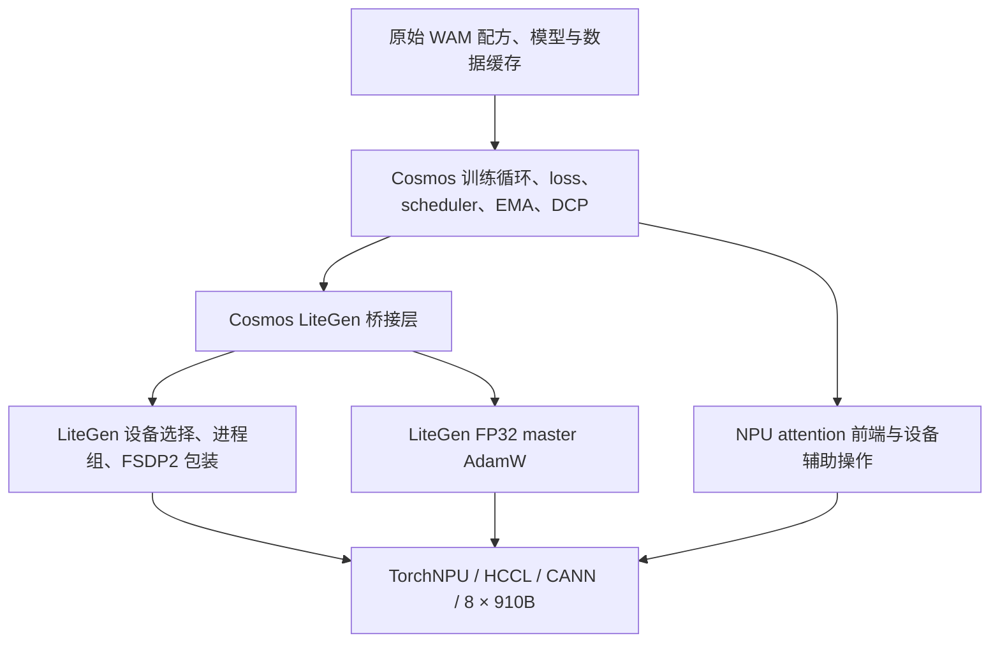
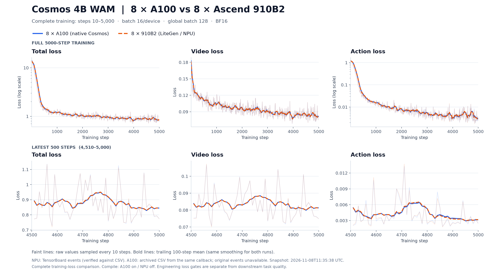
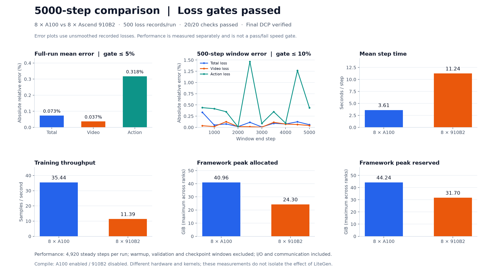

# Cosmos 4B WAM 接入 LiteGen 的国产卡适配实验说明

记录日期：2026-11-08（UTC）。本说明对应 task27 纯 WAM、单机八卡的已完成实验。完整源码、安装方式和复现命令见 [README](../README.md)。

## 1. 实验目标与结论

目标是将原 `/mnt/lvminrui/workspace/cosmos-training` 的 4B WAM 训练任务迁移到 910B，通过 LiteGen 统一硬件和分布式接入，并保持原训练配方与 loss 下降趋势。

结论：**修复后的代码完成 8 × Ascend910B2 两步功能验收，并从原始预训练 DCP 完成 5000 步训练；相对原生 8 × A100 记录，20 项工程对齐检查全部通过。** 三类 loss 的全程均值与各 500 步窗口均满足原阈值，最终四类检查点完整。NPU 训练使用 `LITEGEN_DEVICE=npu` 和八个 rank，没有以 CPU 或随机小模型替代真实 4B 训练。

这里的“一致”指已定义范围内的训练配置和 loss 趋势对齐。attention、优化器实现、通信、RNG 和 compile 策略存在后端差异；没有证明跨硬件逐位一致、所有分支等价、任务成功率一致或速度相同。

## 2. 来源与实验对象

| 对象 | 来源 / 身份 |
|---|---|
| 原生 Cosmos 工作区 | `/mnt/lvminrui/workspace/cosmos-training`；复核 HEAD `6b9705f202beb513cdefcbdcb0a9395987c5c22f` |
| 迁移源 | `/mnt/lvminrui/workspace/cosmos-litgen-npu-migration`；HEAD `60655e9c7bb8581bab95c2470816cf150e5bc57d` 加工作区修复 |
| LiteGen 比较基准 | `/mnt/lvminrui/workspace/LiteGen.dev`，`ceff826ad729151fb385b1f4df787ebc4b5bd888` |
| A100 基线 | `reference/wam-steps5k-8xA100`，原生 8 × A100，5000 步 |
| 910B 正式实验 | `/mnt/lvminrui/workspace/mrlv/wam-910b-8x-5000-20261105T131003Z` |
| 新交付 | `/mnt/lvminrui/workspace/cosmos-training-litegen-910b` |

原导出清单记录的 Cosmos 来源为 `4c965f9cf3620058197cf0218c59e06a6625784c` 的工作区快照；后续比较对象是上表中的当前原生工作区。不能只凭 HEAD 相同与否代替文件比较。交付前按正式实验的源码快照复核 750 个文件，全部一致；本次更新 README、配置模板及证据，不修改训练实现或阈值。

[源码快照哈希](../provenance/validated-source-sha256.json)、[工作区补丁](../provenance/validated-source.patch)、[原导出清单](../provenance/original-migration-manifest.json) 保留了来源。两个项目是实验任务所需的运行时导出，不是完整上游开发仓库；无关示例、CI、推理服务等未随包导出。

## 3. 实测软硬件

| 层次 | 实测值 |
|---|---|
| CPU / 架构 | Kunpeng-920 / Linux aarch64 |
| 系统 / glibc | Ubuntu 22.04.5 LTS / 2.35 |
| NPU | 8 × Ascend910B2，64 GiB HBM/卡 |
| 驱动 / 固件 | 25.5.6 / 7.8.0.10.220 |
| CANN / 910B ops | 9.1.0 / 同版本 910B 包 |
| Python | 镜像原生 3.12.13 |
| Torch / TorchNPU | 2.10.0+cpu / 2.10.0.post6 |
| 环境 | 独立 venv，146 个锁定分发包；新交付不复用旧 editable 环境 |

本机当前 CPU cgroup quota 为 144 核、内存限制 1920 GiB、`/dev/shm` 128 GiB。主机 `lscpu` 显示 192 核不等于容器获得 192 核。完整资源快照和新环境版本见交付复测报告。版本表是实际成功的组合，不推断其他 CANN、TorchNPU 或芯片组合兼容。

## 4. 训练配置及公平比较范围

| 配置 | 原生 A100 | LiteGen + 910B |
|---|---|---|
| 模型与任务 | 4B，task27 纯 WAM | 相同 |
| 初始权重 / 数据缓存 / 动作归一化 | 原始 DCP 和缓存 | 相同输入 |
| 训练步数 | 5000 | 5000 |
| world size / batch / grad accumulation | 8 / 每卡16、全局128 / 1 | 相同 |
| 精度 / seed | BF16 / 42 | 相同配置；不承诺相同硬件 RNG 序列 |
| 学习率 / betas / eps / weight decay | 2e-5 / (0.9,0.99) / 1e-8 / 0.05 | 相同 |
| action2llm / llm2action / action_modality_embed LR 倍率 | 5 | 相同 |
| scheduler | LambdaLinear；cycle 40000、warmup 50 | 相同 |
| loss_scale / action_loss_weight | 10 / 10 | 相同 |
| 梯度裁剪 | norm 1.0 | 相同 |
| PointFlow/FK 与独立模态 schedule | 关闭 | 相同 |
| validation | 开始前及每2000步，max_val_iter=1 | 相同；实际执行开始、2000、4000步验证 |
| 日志 / checkpoint | 每10步 / 第5000步 | 相同 |
| compile | true | **false** |
| 实际优化器 | CUDA FusedAdam | LiteGen MasterShadowAdamW，FP32 master/moments |
| 设备通信 | CUDA / NCCL | NPU / HCCL |

静态复核中 60 个配置源文件逐字节相同，`flow_matching.py`、`rectified_flow.py`、`action_processing.py` 相同，`trainer.training_step` 的语法树相同。正式实验另外比较**最终有效配置**，只允许 `compile.enabled` 不同；不能用配置源文件相同替代启动覆盖后的核对。

证据：[核心逻辑比较](https://github.com/NaOH678/cosmos-training/blob/d49e5f14bea617a6a5bd59ea210cc063bdee09f1/evidence/optimizer-fix/core-functions-comparison.json)、[配置源比较](https://github.com/NaOH678/cosmos-training/blob/d49e5f14bea617a6a5bd59ea210cc063bdee09f1/evidence/optimizer-fix/configuration-comparison.json)、[A100 有效配置](https://github.com/NaOH678/cosmos-training/blob/d49e5f14bea617a6a5bd59ea210cc063bdee09f1/evidence/5000-step/a100_config.yaml)、[NPU 有效配置](https://github.com/NaOH678/cosmos-training/blob/d49e5f14bea617a6a5bd59ea210cc063bdee09f1/evidence/5000-step/npu_config.yaml)、[正式配置复核](https://github.com/NaOH678/cosmos-training/blob/d49e5f14bea617a6a5bd59ea210cc063bdee09f1/evidence/5000-step/original-run/final-config-check.json)。

## 5. LiteGen 的职责与实际改动



桥接层在 `cosmos-training/cosmos_framework/integrations/litegen.py`。它使 Cosmos 保留模型、数据、训练和检查点的所有权，使用 LiteGen 管理设备和分布式准备。模型先在 meta 上构造，`runtime.prepare(model, materialize_meta=False)` 完成分片包装，之后仍由 Cosmos 分配参数、初始化并加载 DCP。decoder block 与根模块的分片方式及 activation checkpoint 准备顺序保留；非标准 forward 方法登记已有 FSDP 钩子。

桥接关闭 LiteGen 自己的 cast、activation checkpoint、compile 和 EMA，避免与 Cosmos 重复执行；这不代表关闭 Cosmos 原有 EMA。当前支持纯 FSDP2：shard 等于 world size、replicate/CP/CFGP 为1；不支持的分支明确报错。

### Cosmos 侧适配

- 原 CUDA 专用的设备、同步、stream/event、autocast、RNG、监控和统计调用接入设备抽象。部分 HCCL 统计从 FP64 改为 FP32，部分 AVG 归约以 SUM/world size 实现。
- `model/attention/npu/__init__.py` 处理真实 NPU attention：常规路径调用 `torch_npu.npu_fusion_attention`；packed 非因果路径用 TND 和序列边界。可微 LSE、确定性或特定边界路径使用 **NPU 上的分块 FP32 参考实现**，不是 CPU fallback，也不是所有路径都融合。
- 优化器工厂在 NPU 上选择 LiteGen FP32 master AdamW，保留参数筛选、参数组、学习率倍率与更新配方。
- DCP 适配 Python 3.12 的历史 pathlib 元数据，RNG 保存/恢复包含八个 NPU rank；跨设备 RNG 状态不被当成可互换格式。
- validation 采样的 Runge–Kutta 路径适配 NPU FP32 统计及近零表达式稳定计算；CUDA 原 FP64 路径保留。
- 数据集按需导入、wandb runid 导入及必要依赖补齐；精简重复的 checkpoint/compile 准备和数据集导出代码，不改 loss 或调度器。

### LiteGen 侧实际差异

相对当前 LiteGen 基准，仅 **4 个运行时文件 + 1 个安装元数据文件**不同，51 个运行时文件相同，没有新增/删除运行时文件。

| 文件 | 目的 |
|---|---|
| `litegen/device/__init__.py` | 增加应用所需设备、精度上下文、RNG、同步与统计接口 |
| `litegen/litegen.py` | 新增 `materialize_meta=False` 及必要校验；默认行为不变 |
| `litegen/optim/master_shadow.py` | 修复 master 延迟初始化和空状态恢复 |
| `litegen/optim/prepare.py` | 跳过未初始化的空源状态 |
| `pyproject.toml` | NPU 交付元数据与 Python 3.12 范围，由外层锁文件统一依赖 |

`NpuBackend`、HCCL 后端选择、FSDP2、register、自定义 forward 钩子以及 FP32 master 主体能力在基准 LiteGen 已经存在，不能归为此次新增。[详细差异说明](litegen_changes.md) 保留在本项目，[实际补丁](https://github.com/NaOH678/cosmos-training/blob/d49e5f14bea617a6a5bd59ea210cc063bdee09f1/evidence/litegen-diff/runtime-and-packaging.patch) 可从 Git 历史归档查看。

LiteGen 的收益是集中硬件接口、复用分布式与精度设施、减少模型代码对设备 API 的直接耦合，并让后续维护聚焦在明确的桥接边界。当前证据未分离 LiteGen 的单独开销，因此不能声称接入带来了训练加速。

## 6. 关键正确性问题：原生初始化时序

曾发现 optimizer 构造时立即复制 FP32 master，随后 Cosmos 才加载模型 DCP。第一次更新会把加载前的随机 master 写回模型，学习率为0也可能发生：

```text
旧顺序：随机参数0.25 → master=0.25 → DCP加载为2.0 → 更新写回0.25
修复后：构造空状态 → DCP加载为2.0 → 首次有梯度时master=2.0 → 正常更新
```

修复将 master/moments 创建延迟到首次有梯度更新；已有非空优化器状态恢复时保留 FP32 master/moments，不经 BF16 中转；空状态保持延迟。配套准备逻辑跳过 `{}`。这与原生 FusedAdam 的初始化时序一致，未重写 AdamW 公式。

修复前9个新增回归用例失败，修复后50项针对性测试通过；真实910B上 BF16/FP32、零/非零学习率四组更新与 FP32 AdamW 对照逐位符合。随后重新做完整两步验收并启动本次5000步。更早的两份 smoke checkpoint 仅作诊断，不能继续作为正式起点。

证据：[修复审查](https://github.com/NaOH678/cosmos-training/blob/d49e5f14bea617a6a5bd59ea210cc063bdee09f1/evidence/optimizer-fix/review_summary.json)、[修复前测试](https://github.com/NaOH678/cosmos-training/blob/d49e5f14bea617a6a5bd59ea210cc063bdee09f1/evidence/optimizer-fix/regression-before.log)、[修复后测试](https://github.com/NaOH678/cosmos-training/blob/d49e5f14bea617a6a5bd59ea210cc063bdee09f1/evidence/optimizer-fix/regression-after.log)、[真实 NPU optimizer 对照](https://github.com/NaOH678/cosmos-training/blob/d49e5f14bea617a6a5bd59ea210cc063bdee09f1/evidence/optimizer-fix/master-warmstart-npu-after.json)。历史报告中“未做5000步”描述的是当时状态，本说明追加了后续完整实验结果。

## 7. 验证过程与完成证据

| 层级 | 实际结果 | 证据 |
|---|---|---|
| 八卡预检 | 八张910B BF16运算、同步、版本通过 | [preflight.json](https://github.com/NaOH678/cosmos-training/blob/d49e5f14bea617a6a5bd59ea210cc063bdee09f1/evidence/two-step-20261105/preflight.json) |
| NPU attention | 5项实际执行通过，0跳过 | [attention.xml](https://github.com/NaOH678/cosmos-training/blob/d49e5f14bea617a6a5bd59ea210cc063bdee09f1/evidence/two-step-20261105/attention.xml) |
| 两卡 LiteGen | FSDP2、FP32 master、RNG/DCP恢复及恢复后更新通过 | [result.json](https://github.com/NaOH678/cosmos-training/blob/d49e5f14bea617a6a5bd59ea210cc063bdee09f1/evidence/two-step-20261105/fsdp-dcp/result.json) |
| 八卡两步 WAM | step=2，三类loss有限，完整DCP，passed/true | [status.json](https://github.com/NaOH678/cosmos-training/blob/d49e5f14bea617a6a5bd59ea210cc063bdee09f1/evidence/two-step-20261105/status.json)、[wam_result.json](https://github.com/NaOH678/cosmos-training/blob/d49e5f14bea617a6a5bd59ea210cc063bdee09f1/evidence/two-step-20261105/wam_result.json) |
| 正式5000步 | 八rank、最终5000步、exit code 0、500个记录点/指标 | [completion.json](https://github.com/NaOH678/cosmos-training/blob/d49e5f14bea617a6a5bd59ea210cc063bdee09f1/evidence/5000-step/completion.json)、[console.log](https://github.com/NaOH678/cosmos-training/blob/d49e5f14bea617a6a5bd59ea210cc063bdee09f1/evidence/5000-step/original-run/console.log) |
| 正式配置与loss | 原有20项检查全部通过 | [alignment.json](https://github.com/NaOH678/cosmos-training/blob/d49e5f14bea617a6a5bd59ea210cc063bdee09f1/evidence/5000-step/alignment.json) |
| 最终DCP | 四组件完整，全部引用和字节边界通过；小状态实际回读 | [checkpoint_verification.json](https://github.com/NaOH678/cosmos-training/blob/d49e5f14bea617a6a5bd59ea210cc063bdee09f1/evidence/5000-step/checkpoint_verification.json) |

正式任务开始于 **2026-11-05 13:13:16 UTC**，结束于 **2026-11-06 04:57:02 UTC**，总时长 **15小时43分46秒**（含启动和比较）。validation 在起始、2000和4000步执行，对应 loss 约47.4461、1.205314、1.56352；这里只作为验证路径实际执行的证据，没有将这三点扩展为跨设备任务质量对齐。

新路径使用全新 venv 的重复验收结果单列于 [delivery_validation.md](delivery_validation.md)。本次打包不重新执行另一轮5000步。

## 8. 完整5000步 loss 对比

两侧每10步记录一次，共500点，比较步骤10至5000。NPU TensorBoard 三项指标的每一个记录点均与 CSV 完全一致；A100 使用当时同一监控回调保存的 CSV，其原始 TensorBoard event 未在当前挂载中找到。不会把 A100 CSV 冒充已读取的 event。

全程误差定义为 `abs(mean(NPU)-mean(A100))/abs(mean(A100))`；每500步窗口包含50个记录点，共10个窗口。均值门槛≤5%，每个窗口门槛≤10%，原阈值未放宽。图中粗线为100步 trailing mean，淡线保留原始记录；统计与验收使用原始点，不使用平滑结果。

| loss | A100全程均值 | 910B全程均值 | 均值相对差 | 最差500步窗口差 | 结果 |
|---|---:|---:|---:|---:|---|
| total | 1.3773676903 | 1.3763632822 | 0.072922% | 0.335968% | 通过 |
| video | 0.0951570405 | 0.0951917922 | 0.036520% | 0.126367% | 通过 |
| action | 0.0425797299 | 0.0424445344 | 0.317511% | 1.463846% | 通过 |

| 第5000步 | A100 | 910B |
|---|---:|---:|
| total | 0.7735334635 | 0.7736555934 |
| video | 0.0748597607 | 0.0749322101 |
| action | 0.0024935857 | 0.0024333494 |



[PDF](https://github.com/NaOH678/cosmos-training/blob/d49e5f14bea617a6a5bd59ea210cc063bdee09f1/evidence/5000-step/loss_comparison.pdf) · [SVG](https://github.com/NaOH678/cosmos-training/blob/d49e5f14bea617a6a5bd59ea210cc063bdee09f1/evidence/5000-step/loss_comparison.svg) · [逐点对齐数据](https://github.com/NaOH678/cosmos-training/blob/d49e5f14bea617a6a5bd59ea210cc063bdee09f1/evidence/5000-step/aligned_losses.csv) · [窗口统计](https://github.com/NaOH678/cosmos-training/blob/d49e5f14bea617a6a5bd59ea210cc063bdee09f1/evidence/5000-step/window_comparison.csv)。本结论针对该任务、种子、输入和配置；单次对齐不是多种子统计检验。

## 9. 性能单独报告

按最大 rank 墙钟时间计时，包含数据等待、通信与日志；排除 warmup、validation、checkpoint 窗口后两边各测量4920步。

| 指标 | 8 × A100 | 8 × 910B |
|---|---:|---:|
| 平均步耗时 | 3.6115 s | 11.2407 s |
| 全局吞吐 | 35.4422 samples/s | 11.3872 samples/s |
| peak allocated | 40.9632 GiB | 24.2958 GiB |
| peak reserved | 44.2383 GiB | 31.6992 GiB |

本实验910B步耗时约为A100的3.112倍，吞吐约为32.13%。显存值是框架allocator统计，不能当成整卡总占用。硬件、attention kernel、优化器实现和compile策略不同，不能据此单独归因LiteGen；本轮主要目标是正确迁移与loss趋势对齐。



## 10. 检查点完整性与边界

最终完整 DCP 位于原共享卷：

```text
/mnt/lvminrui/workspace/mrlv/wam-910b-8x-5000-20261105T131003Z/output/cosmos3_action/action_sft/sim_task27_wam_910b_align5k/checkpoints/iter_000005000
```

总大小约 **34.7712 GiB**，没有复制到源码交付包。model与optim各8个非空分片，trainer也有8个；scheduler只有rank0非空，其余7个为合法去重空分片。检查了所有元数据引用及chunk字节边界，实际回读 `trainer.iteration=5000`、`scheduler.last_epoch=5000` 与八份NPU RNG。优化器元数据包含各322项FP32 master、exp_avg、exp_avg_sq。

此次最终检查没有把5000步完整model/optim重新加载并再训练一次；精确恢复与恢复后更新已由两卡小模型验收覆盖，不能把两者混为完整4B续训实测。

## 11. 交付范围与后续使用

安装、外部输入、两步验收、5000步正式训练、后台启动和对齐命令均见 README。迁移包保留源码、安装流程、验收脚本和对齐基线；历史实验附件与曲线通过本文的固定 Git 归档链接查看。模型权重、训练缓存、环境二进制或最终35GiB级checkpoint不随包分发，由目标集群准备。

当前范围不涵盖原生工作区新增的可选模式混合/四塔分支、PointFlow/FK、NPU sparse/neighborhood attention、多机/HSDP或NPU compile；没有在本NPU容器重新做CUDA硬件回归，也没有下游任务成功率评估。跨机器迁移必须重做实际设备和输入验收；保持原loss阈值和训练配方。
