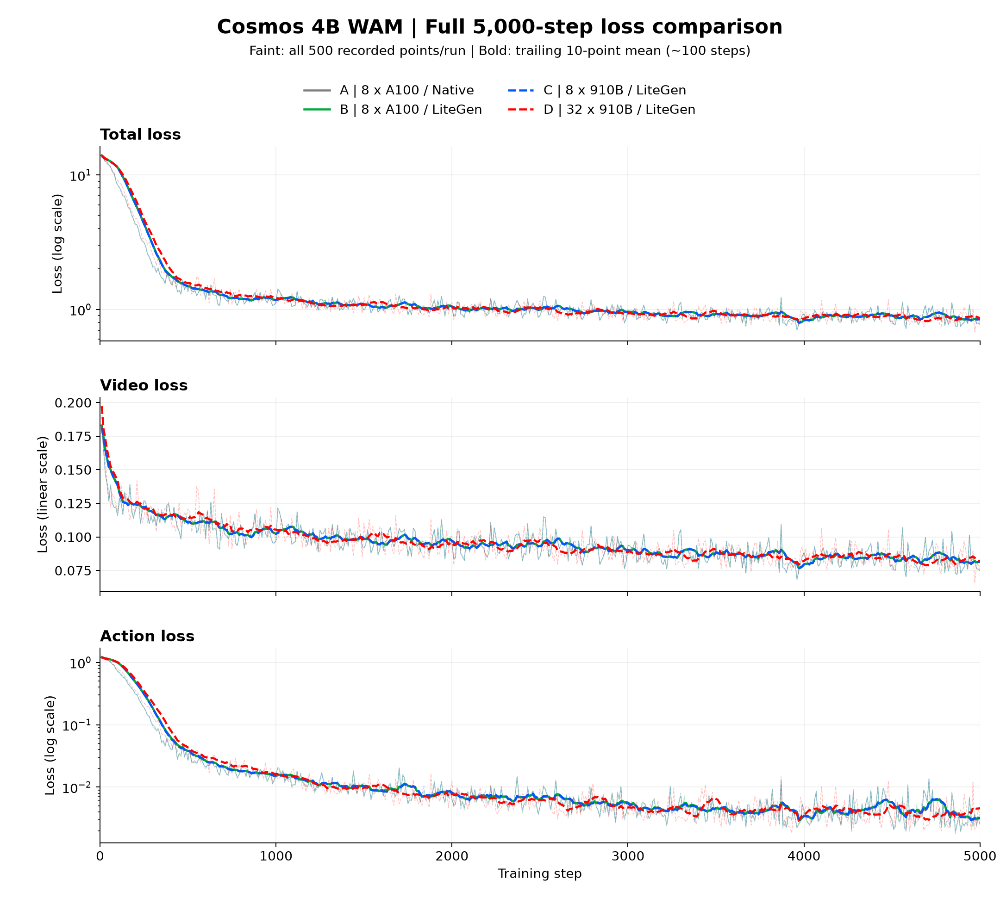
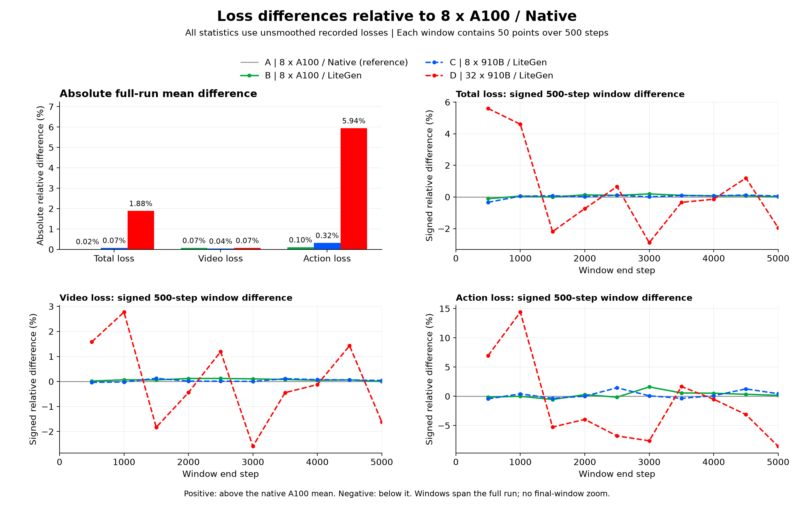
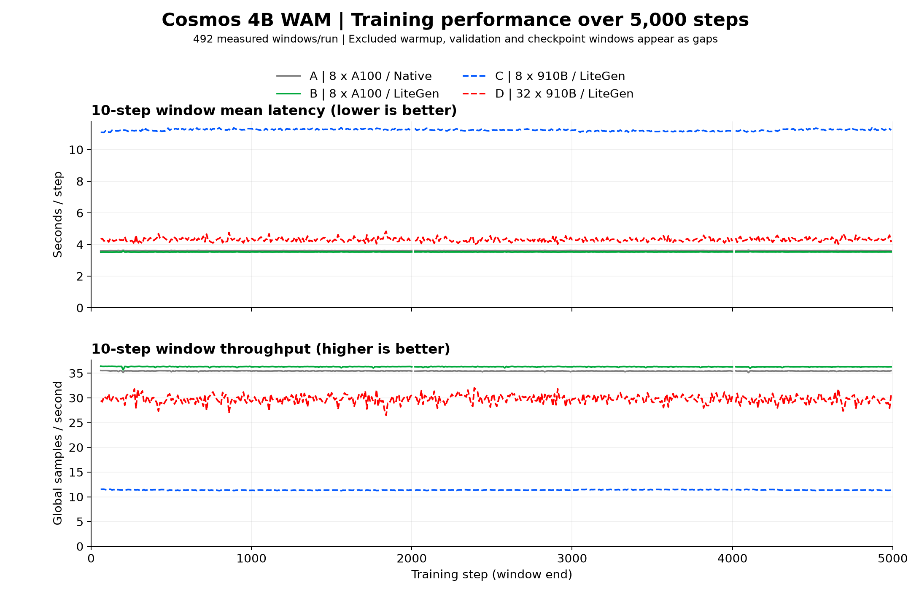
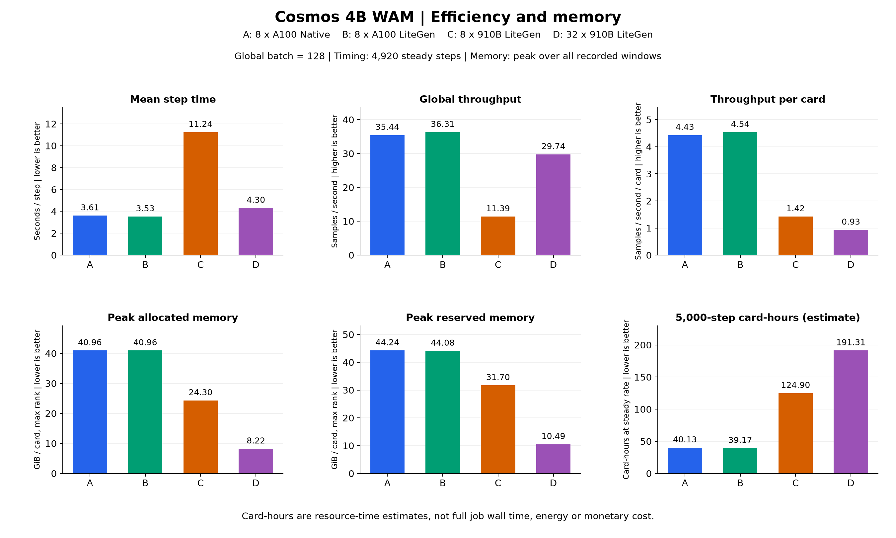

# Cosmos 4B WAM：四组 5000 步实验对比

本报告依据同级 `reference/` 中四组归档数据，比较完整训练过程的 loss 下降趋势、训练效率和显存占用。四组均有第 10 至 5000 步的完整指标记录，三类 loss 均为有限值，整体下降趋势一致。

主要结果：

- **A100 接入 LiteGen 前后**：loss 曲线高度接近；本次记录的吞吐从 35.442 增至 36.305 samples/s，增加约 **2.44%**。这是两次运行的观测差异，没有重复实验和置信区间，不据此承诺固定加速比例。
- **8 × 910B 接入 LiteGen**：三类 loss 的全程曲线与 A100 对照接近，稳态平均耗时为 **11.241 s/step**。
- **32 × 910B 接入 LiteGen**：维持 global batch 128，三类 loss 继续呈整体下降趋势；稳态耗时降至 **4.304 s/step**，相对 8 × 910B 加速 **2.61 倍**，四倍卡数对应的扩展效率为 **65.3%**。
- **速度与资源使用**：32 × 910B 吞吐约为原生 8 × A100 的 **83.9%**、LiteGen 8 × A100 的 **81.9%**；相对 8 × 910B，训练更快、单卡显存更低，但同等步数的稳态卡时约为其 **1.53 倍**。

## 1. 实验与比较条件

| 编号 | 实验及原始数据 | 卡数 | 每卡 batch | FSDP 分片数 | compile | 实际优化器后端 |
|---|---|---:|---:|---:|---|---|
| A | [原生 Cosmos，8 × A100](../wam-steps5k-8xA100/) | 8 | 16 | 8 | 开启 | CUDA FusedAdam，FP32 master weights |
| B | [Cosmos + LiteGen，8 × A100](../wam-steps5k-8xA100-LiteGen/) | 8 | 16 | 8 | 开启 | CUDA FusedAdam，FP32 master weights |
| C | [Cosmos + LiteGen，8 × 910B](../wam-steps5k-8x910B-LiteGen/) | 8 | 16 | 8 | 关闭 | LiteGen MasterShadowAdamW，FP32 master weights / moments |
| D | [Cosmos + LiteGen，4 节点 32 × 910B](../wam-steps5k-32x910B-LiteGen/) | 32 | 4 | 32 | 关闭 | LiteGen MasterShadowAdamW，FP32 master weights / moments |

共同配置为：5000 步、global batch 128、梯度累积 1、BF16、seed 42；优化器基础学习率 `2e-5`、betas `(0.9, 0.99)`、eps `1e-8`、weight decay `0.05`，scheduler warmup 为 50 步。四组记录的预训练检查点与数据 bundle 路径相同，随附动作归一化统计内容一致。

复用项目的 `numerical_config()` 比较方法，忽略输出名称与归一化副本路径后：B 与 A 无配置差异；C 与 A 仅 `compile.enabled` 不同；D 还调整了训练 `batch_size`、`max_samples_per_batch` 和 `data_parallel_shard_degree`。字段差异已写入 [summary.json](summary.json)。分片和每 rank batch 改变后，样本分配及随机数消费顺序可能改变，不能把各组同一步视为相同 minibatch 的逐元素比较。

NPU 配置文件中的 `optimizer_type: FusedAdam` 是保留的配置入口，实际由[优化器工厂](../../cosmos-training/cosmos_framework/utils/generator/optimizer.py)分发到 LiteGen `MasterShadowAdamW`；因此报告明确区分配置名称与执行实现。跨设备性能同时受到芯片、compile、优化器后端及通信等因素影响，不能把全部速度或显存差异归因于 LiteGen。

## 2. 完整 loss 曲线



[下载 SVG 矢量图](loss_full.svg)

- 三个面板依次为 `train/loss`、`train/video_loss`、`train/action_loss`，均显示完整 5000 步范围，没有末段放大图。
- 浅色细线展示每组全部 500 个原始记录点；深色线为向后 10 个记录点的移动平均，约覆盖 100 个训练步，开头不足 10 点时使用已有点。
- Total loss 和 Action loss 使用对数纵轴，便于同时看清初期快速下降和后续趋势；Video loss 使用线性纵轴。横轴均为训练步数。
- loss 每 10 步采样一次，记录的是该步跨 rank 聚合的训练 loss，**不是连续 10 步的平均 loss**。所有图表统一使用灰色、亮绿、亮蓝、大红四种颜色区分 A/B/C/D；A100 两组使用实线，910B 两组使用虚线。

以下均值基于全部 500 个原始记录点，不基于平滑曲线计算：

| 实验 | Total loss 全程记录均值 | Video loss 全程记录均值 | Action loss 全程记录均值 |
|---|---:|---:|---:|
| A：8 × A100 原生 | 1.377368 | 0.095157 | 0.042580 |
| B：8 × A100 LiteGen | 1.377591 | 0.095222 | 0.042537 |
| C：8 × 910B LiteGen | 1.376363 | 0.095192 | 0.042445 |
| D：32 × 910B LiteGen | 1.403326 | 0.095222 | 0.045110 |

首末记录值如下；端点属于单次 minibatch 观测，应结合完整曲线阅读：

| 实验 | Total loss：step 10 → 5000 | Video loss：step 10 → 5000 | Action loss：step 10 → 5000 |
|---|---:|---:|---:|
| A | 13.992070 → 0.773533 | 0.182920 → 0.074860 | 1.216287 → 0.002494 |
| B | 13.991953 → 0.774024 | 0.182907 → 0.074821 | 1.216288 → 0.002581 |
| C | 13.789311 → 0.773656 | 0.181396 → 0.074932 | 1.197535 → 0.002433 |
| D | 13.991405 → 0.790655 | 0.197275 → 0.075715 | 1.201865 → 0.003350 |

## 3. 相对原生 8 × A100 的 loss 差异及原因



[下载 SVG 矢量图](loss_difference.svg)

左上图比较 B/C/D 三组相对 A 的**全程记录均值相对差的绝对值**：`100 × abs(mean(candidate) / mean(A) - 1)`。它不是逐点绝对误差的平均值。

其余三个面板分别展示 Total、Video、Action loss 的**有符号 500 步窗口均值相对差**：`100 × (mean(candidate_window) / mean(A_window) - 1)`。正数表示高于 A，负数表示低于 A；灰色零线是 A 基准。每个窗口包含 50 个未平滑记录点，十个窗口覆盖完整 1–5000 步，末个点只是其中一个窗口，不是最后 500 步的放大图。

| 对照 A 的实验 | Total loss 全程均值有符号差 | Video loss 全程均值有符号差 | Action loss 全程均值有符号差 |
|---|---:|---:|---:|
| B：8 × A100 LiteGen | +0.0162% | +0.0684% | −0.1005% |
| C：8 × 910B LiteGen | −0.0729% | +0.0365% | −0.3175% |
| D：32 × 910B LiteGen | +1.8846% | +0.0685% | +5.9432% |

32 卡的较大差异主要体现在 Action loss：第 501–1000 步窗口均值高约 14.40%，之后多个窗口转为低于 A。它不是训练全过程持续向同一方向偏移。Action loss 后期基准值很小，相同绝对差会表现为更大的百分比；全程均值又会受到初期较大 loss 的影响，不能只看一个百分比判断训练效果。

### 为什么固定 seed=42 和 global batch=128 仍会出现差异

**随机数与 global rank 挂钩，是这次扩卡比较必须说明的因素。** 这不是 LiteGen 新增的规则：已核对原生 Cosmos 和当前接入代码，都由 [trainer](../../cosmos-training/cosmos_framework/trainer/__init__.py#L111) 调用 `set_random_seed(seed=42, by_rank=True)`；[随机种子工具](../../cosmos-training/cosmos_framework/utils/misc.py#L130) 的实际逻辑是：

```python
seed = configured_seed + distributed.get_rank()
random.seed(seed)
np.random.seed(seed)
torch.manual_seed(seed)
```

这里的 rank 是整个分布式作业的 **global rank**，不是每个节点重复的 local rank。

| 项目 | 8 卡实验 | 32 卡实验 |
|---|---|---|
| global rank | 0–7 | 0–31 |
| rank 派生初始种子 | 42–49 | 42–73 |
| 每 rank batch | 16 | 4 |
| 每次更新组合方式 | 8 个 rank × 16 样本 | 32 个 rank × 4 样本 |

因此，`8 × 16 = 32 × 4 = 128` 只保证每次更新的全局样本数量相同，**不保证“样本 ID → rank → 随机数流 → 噪声/时间步”的映射相同**。同一个样本换到不同 rank，会对应不同的随机流；即使留在同一个 rank，每次调用的 batch 大小与此前消耗的随机数数量也可能不同。更多 rank 不意味着“随机性更大”，这里改变的是随机流与样本的具体配对。

这会通过以下路径影响训练：

1. **噪声和扩散时间步影响每次实际求解的训练目标。** [时间步采样器](../../cosmos-training/cosmos_framework/model/generator/diffusion/rectified_flow.py#L134) 使用随机采样；[WAM 加噪过程](../../cosmos-training/cosmos_framework/model/generator/omni_mot_model.py#L1940) 分别为视频和动作生成噪声。配对发生变化后，相同原始数据也不再构成相同的带噪训练样本，梯度与后续优化轨迹会发生变化。
2. **数据分配也与 rank/worker 有关。** 实际使用的 [ActionIterableShuffleDataset](../../cosmos-training/cosmos_framework/data/generator/action/datasets/action_sft_dataset.py#L45) 先按 `42 + epoch` 生成共同的块排列，再按 `global_shard = rank × num_workers + worker_id` 和 `total_shards = world_size × num_workers` 切片。四组每 rank 都是 4 个 worker，因此从 8 卡的 32 个数据流变成 32 卡的 128 个数据流。共同的 shuffle seed 不代表相同的 rank 分配或相同的逐步 minibatch。
3. **分布式与设备数值路径也存在差异。** 8 → 32 卡改变了 FSDP 分片数及梯度归约路径；与原生 A100 比较还同时包含 NPU 算子、compile 开关及优化器后端的差异。浮点舍入和算子实现可能进一步影响长期训练轨迹。

源码还有一个条件分支：当 `torch.are_deterministic_algorithms_enabled()` 为真且传入 iteration 时，时间步生成器使用 `iteration × 65536 + rank`，噪声生成器使用 `iteration × 65536 + rank + 32768`。**这条确定性路径仍然包含 rank，因此确定性不等于跨 world size 的随机数对齐。** 四组归档中的 `trainer.cudnn.deterministic` 均为 false，默认启动入口也没有传入 `--deterministic`；该配置字段本身不能证明每个时刻的全局算法开关状态，所以本报告不把上述条件公式当作历史运行已逐步采证的事实。前述无条件的 `42 + rank` 初始化和数据分片机制则已由源码确认。

这些机制解释了为什么扩到 32 卡后，不能要求 loss 与 8 卡逐步重合，也与当前“整体下降趋势相同、局部差异更明显”的观测相容。但现有四组记录没有逐样本噪声、时间步和随机状态跟踪，也没有分别固定随机映射、样本顺序与归约路径的消融实验，**尚不能量化各因素贡献，更不能断言 5.9432% 的 Action loss 均值差全部由随机数造成**。若后续要研究严格的跨规模一致性，需要以全局样本/更新编号绑定随机数，再进行专门对照；本次仅补充分析，不改变训练逻辑或既定配置。

## 4. 性能随训练步数的变化



[下载 SVG 矢量图](performance_curves.svg)

上图每点来自 `performance_windows.csv` 中一个 10 步窗口：上面为窗口时间除以步数，下面为窗口全局样本数除以时间。图中没有对性能数据额外平滑。

四组均有 500 个性能窗口，其中 492 个稳态窗口共计 4920 步。以下窗口依照原始 `excluded_reason` 排除，图中保留断点，不插值：step 1–50（预热，首个窗口还含验证）、2001–2010 和 4001–4010（验证）、4991–5000（保存检查点）。**这些性能排除规则不用于删除 loss 点。**

窗口时间使用同步后的跨 rank 最大墙钟耗时，包含窗口内的数据加载、通信和日志等工作。因此该指标反映训练链路的实际稳态速度，不等于单个算子的计算时间。统计实现见 [training_monitor.py](../../migration/training_monitor.py)。

## 5. 效率与显存汇总



[下载 SVG 矢量图](performance_summary.svg)

| 实验 | 平均 s/step ↓ | 全局 samples/s ↑ | 每卡 samples/s ↑ | 峰值 allocated GiB/卡 | 峰值 reserved GiB/卡 |
|---|---:|---:|---:|---:|---:|
| A | 3.6115 | 35.442 | 4.430 | 40.963 | 44.238 |
| B | 3.5257 | 36.305 | 4.538 | 40.963 | 44.082 |
| C | 11.2407 | 11.387 | 1.423 | 24.296 | 31.699 |
| D | 4.3045 | 29.736 | 0.929 | 8.223 | 10.488 |

| 实验 | 按稳态速度估算 5000 步小时数 | 按稳态速度估算 5000 步卡时 |
|---|---:|---:|
| A | 5.016 | 40.13 |
| B | 4.897 | 39.17 |
| C | 15.612 | 124.90 |
| D | 5.978 | 191.31 |

图中六项指标的含义与计算方式：

1. **平均步耗时**：有效窗口总秒数 / 有效窗口总步数，越低越快。
2. **全局吞吐**：有效窗口的全局样本总数 / 总秒数；本任务等于 `128 / 平均步耗时`，不是各窗口吞吐的简单平均。
3. **每卡吞吐**：全局吞吐 / 卡数，用于观察增加设备后平均到单卡的产出；它不是单独训练一张卡的实测速度。
4. **峰值 allocated 显存**：框架分配器记录的已分配内存峰值，取所有记录窗口、所有 rank 的最大值，是单卡峰值，不是全体设备的显存总和。
5. **峰值 reserved 显存**：框架分配器保留的内存峰值，包含可复用缓存；同样取全部窗口和 rank 的最大值，不等于 `npu-smi` / `nvidia-smi` 的整卡占用。显存汇总包含预热等被性能计时排除的窗口。
6. **5000 步卡时估算**：`平均步耗时 × 5000 × 卡数 / 3600`，描述设备数量与时间的乘积。小时数估算则不乘卡数。二者都不包含完整任务启动、预热、验证、保存与退出等额外开销，不能当作作业实际墙钟时间或货币成本。

8 → 32 张 910B 保持 global batch 不变，属于固定工作量的扩展比较：加速比为 `11.240654 / 4.304488 = 2.6114`，扩展效率为 `2.6114 / (32/8) = 65.28%`。每卡 batch 从 16 降为 4，FSDP 分片数从 8 增为 32，同时引入跨节点通信；单卡显存下降符合这种配置变化，不能单独解释为某一优化器或平台功能的节省。

## 6. 数据来源、检查和重现

每个实验读取五个文件：`metrics.csv`、`performance_windows.csv`、`performance.json`、`action_stats.json` 以及 `cosmos3_action/action_sft/<原实验名>/config.yaml`。本目录直接引用相邻四组数据，没有复制或改写它们。

生成脚本执行以下检查：loss 点覆盖 step 10–5000 且间隔为 10，loss 有限并可用于对数绘图；性能窗口连续覆盖 1–5000；每个窗口的样本数与 global batch 匹配；由窗口重新计算的耗时、吞吐和显存峰值与原 `performance.json` 一致；四组归一化统计内容一致。全部 20 个输入文件的 SHA256 保存在 [summary.json](summary.json) 中。

在项目根目录，用已安装项目依赖的 Python 环境执行：

```bash
python reference/comparison-four-runs/generate_report.py
```

这里的 `python` 应指向已安装好的 venv 解释器，也可以直接使用该 venv 的 `bin/python` 路径。脚本仅需已交付依赖中的 NumPy、Pandas、Matplotlib 和 PyYAML，不导入 Torch、不加载模型、不要求 NPU 或原始模型/数据挂载。它根据自身路径定位输入，与执行时的当前目录无关。

命令重新生成四张 PNG、对应的四张 SVG 和 `summary.json`（含完整和分窗口 loss 差异）；本 Markdown 文档是这四组固定实验的说明。图中文字采用英文，以便在没有额外中文字体的新镜像中直接重现；指标解释在本文中给出。重新生成文件后若要重新打包交付，需要同步更新根目录 `MANIFEST.json`。

本报告分析的是已有完整 5000 步记录，不是两步功能验收；本轮没有重新训练或检查历史完整 DCP，也没有进行独立任务成功率、泛化能力或能耗评测。loss 下降趋势、训练速度与最终任务效果应分别评价。
